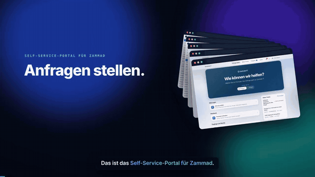
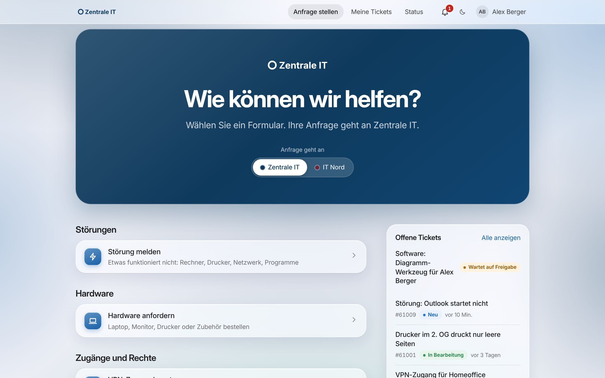
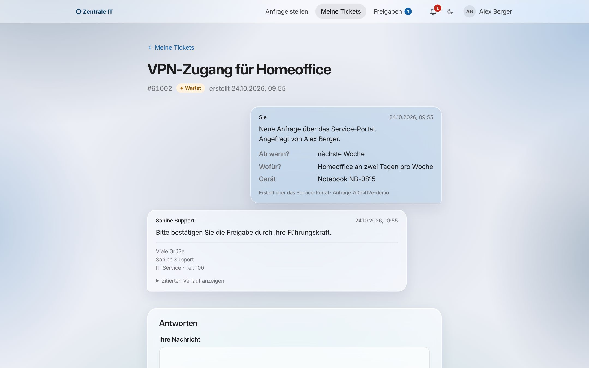
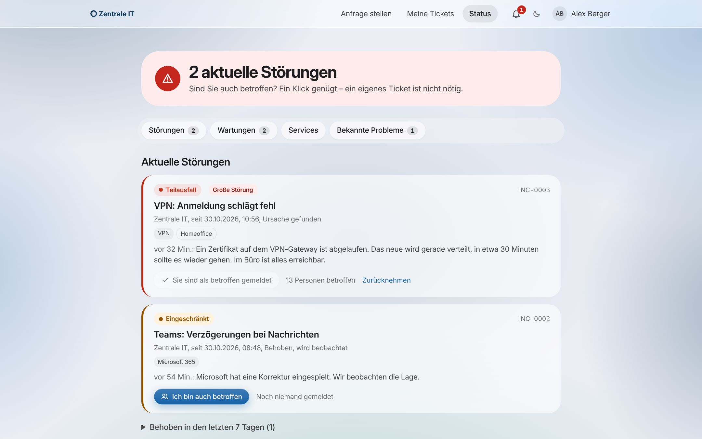
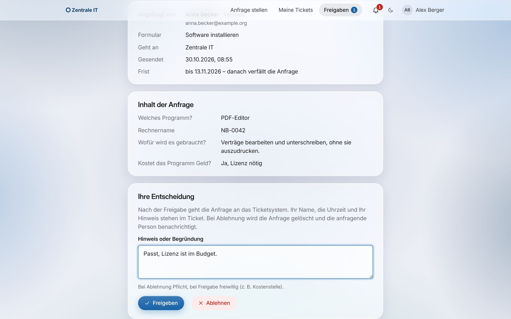

# Zammad Self-Service-Portal

Self-Service-Portal für IT-Abteilungen mit einem oder mehreren Zammad-Systemen: Mitarbeitende melden sich mit ihrem Microsoft-Konto an, füllen ein passendes Formular aus und sehen jederzeit, was aus ihrer Anfrage geworden ist. Die IT bekommt saubere Tickets – mit Gruppe, Priorität, Feldern und, wo nötig, der Freigabe der Führungskraft.

**[Webseite mit Video](https://hundexe.github.io/Zammad-Service-Portal/)** · **[Online-Demo zum Durchklicken](https://hundexe.github.io/Zammad-Service-Portal/demo/)** · [Installation](#installation-mit-einem-befehl) · [Dokumentation](https://hundexe.github.io/Zammad-Service-Portal/doku/)

[](https://hundexe.github.io/Zammad-Service-Portal/#video)

Die Einführung im Video (3:18, mit Sprecher und Untertiteln) zeigt Anmeldung, Formulare mit Prüfung und Bedingungen, Freigabe durch die Führungskraft, Ticketverlauf und Benachrichtigungen, Status-Seite mit „Ich bin auch betroffen“, helles und dunkles Design, Baukasten mit einfacher und erweiterter Ansicht, Weiterleitung, Stile, Störungen und Probleme, Funktionsschalter, Verwaltung und Sicherheit. [Mit Ton auf der Webseite ansehen](https://hundexe.github.io/Zammad-Service-Portal/#video) oder [herunterladen](docs/video/service-portal-demo.mp4) ([Untertitel](docs/video/service-portal-demo.srt)).

**Aktuelle Version: 1.13.0** – neu: das Portal als App installieren und **per Intune auf alle Geräte verteilen**. Seit 1.12: Status-Seite mit Störungen, Wartungen, Service-Status und bekannten Problemen, „Ich bin auch betroffen“ statt doppelter Tickets, jede Funktion einzeln schaltbar. Alle [Änderungen](CHANGELOG.md), externes Review: [was geändert wurde](docs/REVIEW-2026-10.md), alle [Sicherheitsprüfungen](https://hundexe.github.io/Zammad-Service-Portal/doku/pruefungen.html).

 
 

## Was das Portal kann

**Für Mitarbeitende**

- **Anmelden mit Microsoft** (Entra ID, Mehrfaktor nach Ihrer Richtlinie) – kein eigenes Passwort
- **Formulare** nach Themen sortiert, mit Pflichtfeldern, verständlichen Fehlermeldungen, Feldern, die nur bei Bedarf erscheinen, Datei-Anhängen mit Virenscan und Vorbelegung aus dem Profil
- **Freigabe durch die Führungskraft**, wo es etwas kostet: Die Anfrage wartet im Portal und geht erst danach an die IT – mit Erinnerung, Frist und Vermerk im Ticket
- **Meine Tickets** mit Verlauf wie im Chat (ohne doppelte Zitate und interne Notizen), Antworten direkt aus dem Portal und **Glocke**, sobald die IT antwortet
- **Status-Seite** mit aktuellen Störungen, geplanten Wartungen, dem Zustand aller Services und bekannten Problemen mit Lösung; **„Ich bin auch betroffen“** mit einem Klick statt eines eigenen Tickets – Updates kommen automatisch
- **Als App** im eigenen Fenster mit Symbol in Startmenü und Taskleiste – in Edge und Chrome mit einem Klick installiert, auf iPhone und iPad über „Zum Home-Bildschirm“
- Hell oder dunkel, Handy oder Desktop, barrierearm (Tastatur, Screenreader, geprüfte Kontraste)

**Für die IT**

| Bereich | Funktionen |
| --- | --- |
| Mehrere Ticketsysteme | Beliebig viele Zammad-Instanzen an einem Portal, je System eigene Formulare, Vorlagen, Übersichten, Farben und Logos. Ein Auswahlfeld im Formular kann die Anfrage an ein anderes Ticketsystem oder eine andere Abteilung weiterleiten |
| Status und Störungen | **Neu:** Störungen mit Updates, Banner bei großen Störungen, Liste der Betroffenen, geplante Wartungen, Service-Status, Probleme mit Ursache, Workaround und verknüpften Tickets. Zammad bleibt führend: Tickets zu Störungen und Problemen bekommen dort Tags (`inc-0003`, `prb-0001`) |
| Portal als App | **Neu:** installierbar als Progressive Web App; **Verteilung per Intune** (Edge-Richtlinie `WebAppInstallForceList`) mit fertigem Wert aus der Verwaltung. Symbol in den Farben des Portals, keine Daten auf dem Gerät – [Anleitung](docs/APP.md) |
| Funktionen | Jede Funktion einzeln ein- und ausschaltbar – Status, Störungen, Wartungen, Probleme, Freigabe, Weiterleitung, Benachrichtigungen, App |
| Formular-Baukasten | Ziehen und Ablegen, Live-Vorschau, Bedingungen, Prüfmuster, Felder nur für bestimmte Gruppen, Versionen, optional Vier-Augen-Prinzip, Formulare und Vorlagen als Datei |
| Ansicht Einfach / Erweitert | „Einfach“ zeigt nur, was man im Alltag braucht, „Erweitert“ jede Stellschraube – der Server prüft in beiden gleich |
| Tickets in Zammad | Angelegt im Namen der Person, mit Gruppe, Priorität, Tags und freigegebenen Zammad-Feldern – nur in **erlaubte Gruppen**; Kernfelder wie Besitzer oder Status setzt nie ein Formular |
| Zammad-Objekte | Ticket-Attribute aus dem Objekt-Manager gezielt freigeben, inklusive der erlaubten Werte |
| Rechte und Nachvollziehbarkeit | Rollen global oder je Ticketsystem (Entra-Gruppen, App-Rollen, Personen), lokale Notfallkonten mit Zwei-Faktor-Anmeldung, Audit-Log mit Hash-Kette, Zustellungsübersicht |
| Gestaltung | Fünf Stile (Standard, Glas, Fluent, Material, Kontrast), eigene Farben und Logos, eigene Anmeldeseite |
| Ausfallsicherheit | Anfragen warten verschlüsselt, bis Zammad erreichbar ist – auch nach Neustart, ohne doppelte Tickets |
| Betrieb | Docker oder direkt auf Debian/Ubuntu, Installation mit einem Befehl, Caddy mit TLS, ClamAV, verschlüsselte Ablage, keine npm-Laufzeitabhängigkeiten, Status auf der Server-Konsole, Sicherung und Wiederherstellung, signierte Updates per Klick mit Rollback |

Das Portal legt Tickets **ausschließlich über die Zammad-API** an und verschickt selbst keine E-Mails – Eingangsbestätigungen und Antworten kommen wie gewohnt aus Zammad.

## Installation mit einem Befehl

Auf einem Linux-Server (Debian oder Ubuntu empfohlen):

```bash
curl -fsSL https://raw.githubusercontent.com/Hundexe/Zammad-Service-Portal/main/setup.sh | sudo bash
```

Das Skript fragt, wie das Portal laufen soll, und erledigt den Rest:

| Variante | Für wen | Was passiert |
| --- | --- | --- |
| **1) Docker** | Server mit oder ohne Docker | installiert Docker bei Bedarf, baut und startet den Compose-Stack |
| **2) Direkt auf Debian/Ubuntu** | ohne Docker | installiert Node.js, Caddy und optional ClamAV, richtet systemd-Dienste ein |
| **3) Nur ausprobieren** | zum Anschauen | startet eine Demo mit Beispieldaten, simuliertem Zammad und simuliertem Microsoft-Login; nichts wird dauerhaft eingerichtet |

Danach fragt es Hostname oder IP, Ports (Vorschlag eines freien Ports, falls 443/80 belegt sind), Virenscanner und optional die Microsoft-Anmeldung ab und legt den ersten Admin mit generiertem Passwort an. Ohne Menü: `… | sudo bash -s -- --docker` (bzw. `--debian`, `--demo`). Erneut ausführen aktualisiert das Portal; Einstellungen und Daten bleiben.

**Nur ansehen, ohne Server:** Die [Online-Demo](https://hundexe.github.io/Zammad-Service-Portal/demo/) läuft komplett im Browser. Mit echtem Server im Hintergrund (simuliertes Zammad) geht es mit Node.js ≥ 22.18 auf dem eigenen Rechner:

```bash
git clone https://github.com/Hundexe/Zammad-Service-Portal.git && cd Zammad-Service-Portal && npm run demo
```

und dann <http://localhost:3000> öffnen („Mit Microsoft anmelden“ meldet ohne Passwort als Demo-Admin an).

Die ausführliche Anleitung mit Zammad-API-Benutzer und Zertifikaten steht in [docs/INSTALLATION.md](docs/INSTALLATION.md), die Microsoft-Anmeldung (Entra ID) Schritt für Schritt in [docs/ENTRA.md](docs/ENTRA.md). Für den Betrieb eine feste Version verwenden: `… | sudo PORTAL_REF=vX.Y.Z bash` mit einem signierten Tag aus **Releases**.

## Vor dem Produktivbetrieb

Das Portal ist ein kleines Projekt. Für den Einsatz im Unternehmen empfehlen wir den Weg aus dem Review: eigene VM, einige Wochen mit wenigen IT-Benutzern, dann eine Abteilung, erst danach alle. Was vorher erledigt sein sollte – eigener Fork, nur ein lokales Notfallkonto, ClamAV verpflichtend, Admin-Bereich nur aus dem Admin-Netz, Zammad-API-Benutzer mit Minimalrechten, getestetes Restore, Egress-Firewall, Monitoring, unabhängiger Security-Check – steht mit Prüfanleitung in der **[Go-Live-Checkliste](docs/GO-LIVE.md)**.

## Betrieb auf einen Blick

```bash
cd /opt/zammad-service-portal/deploy
P="docker compose exec app /nodejs/bin/node src/server/cli.ts"   # ohne Docker: service-portal-cli
$P status                 # Warteschlange, Virenscanner, Audit-Log – Exit-Code 2 bei Problemen (fürs Monitoring)
$P scanner:test           # ClamAV mit EICAR-Testdatei prüfen
$P backup                 # Sicherung nach /data/backups/
$P backup:verify DATEI    # Sicherung prüfen (Integrität, Schema, passender Schlüssel)
$P restore DATEI --yes    # Sicherung zurückspielen (Portal vorher stoppen)
bash ../tools/check-hardening.sh   # Container-Härtung prüfen
```

Mehr dazu, inklusive Alarmregeln, Log-Weiterleitung und Egress-Firewall: [docs/BETRIEB.md](docs/BETRIEB.md).

## Dokumentation

Alle Anleitungen gibt es auch lesefreundlich auf der Webseite: **[hundexe.github.io/Zammad-Service-Portal/doku/](https://hundexe.github.io/Zammad-Service-Portal/doku/)**.

| Dokument | Inhalt |
| --- | --- |
| [Installation](docs/INSTALLATION.md) | Ein Befehl oder Schritt für Schritt, mit Docker oder direkt auf Debian |
| [Microsoft-Anmeldung](docs/ENTRA.md) | Entra ID Schritt für Schritt: App-Registrierung, Rechte, Gruppen, zwei Tenants, Test, Fehler |
| [Bedienung](docs/BEDIENUNG.md) | Portal für Mitarbeitende und Verwaltung, mit Screenshots |
| [Portal als App](docs/APP.md) | Als App installieren, per Intune oder Gruppenrichtlinie verteilen, Handys, Sicherheit, Fehlersuche |
| [Architektur](docs/ARCHITEKTUR.md) | Aufbau, Datenfluss, Datenmodell, Zammad-Anbindung |
| [Sicherheit](docs/SICHERHEIT.md) | Schutzmaßnahmen, Bedrohungsmodell, Abgleich mit OWASP |
| [Penetrationstest](docs/PENTEST.md) | Vorgehen, Werkzeuge, Ergebnisse und behobene Funde |
| [Sicherheitstest 28.10.2026](docs/SICHERHEITSTEST-2026-10-28.md) | Zweiter Test mit Schwerpunkt auf den neuen Funktionen, offene Funde mit Issues |
| [Updates](docs/UPDATES.md) | Releases signieren, Updates aus der Oberfläche, Rollback |
| [Betrieb](docs/BETRIEB.md) | Sicherung, Wiederherstellung, Monitoring, Egress-Firewall, Härtung prüfen |
| [Go-Live](docs/GO-LIVE.md) | Checkliste mit Prüfanleitung vor dem Produktivbetrieb |
| [Lasttest](docs/LASTTEST.md) | Messwerte, Ausfall- und Neustart-Szenarien |
| [Review 2026-10](docs/REVIEW-2026-10.md) | Externes Review und was daraus geändert wurde |
| [Entwicklung](docs/ENTWICKLUNG.md) | Lokale Demo, Tests, Screenshots, Webseite und Online-Demo bauen |

## Technik in einem Satz

TypeScript auf Node.js 24 ohne externe Laufzeitpakete (HTTP, Krypto, SQLite und TypeScript bringt Node mit), Frontend ohne Framework mit strenger Content-Security-Policy, Datenhaltung in SQLite. Das spart Angriffsfläche durch fremde Pakete und hält den Stack klein.

## Tests

```bash
npm test                        # 341 Tests: Funktionen, Sicherheit, Review-Punkte, Updater
npm run typecheck
node tools/loadtest.ts          # Lasttest: 50 Logins, 50 Ticketansichten, 20 Anfragen mit Anhang
bash tools/secret-scan.sh       # vor jeder Veröffentlichung: keine Geheimnisse im Repository
```

| Bereich | Was geprüft wird |
| --- | --- |
| Sicherheit | Anmeldung, Sitzungen, CSRF, Rechte, OIDC im Detail, IDOR, Injection, Uploads, SSRF (inkl. IPv6 und TLS), Datenablage, Audit-Log, lokale Anmeldung mit Sperre und 2FA |
| Review und Sicherheitstests | alle Punkte aus dem externen Review und den Sicherheitstests vom Oktober 2026 |
| Freigabe durch Vorgesetzte | Ablauf, Rechte (404 für Fremde, keine Selbstfreigabe), Fristen, Benachrichtigungen |
| Weiterleitung | Ziel je Auswahl, Rechte beim Speichern und Absenden, erlaubte Gruppen, Felder im Ziel, Export mit Kürzel |
| Status und Störungen | Funktionsschalter, Rechte je Ticketsystem, Sichtbarkeit im Portal, „Ich bin auch betroffen“ mit Benachrichtigung, Service-Zustand aus Störungen und Wartungen, Tags in Zammad, Probleme |
| Grundfunktionen | Ende-zu-Ende, Ticketliste und Verlauf, Benachrichtigungen, Verwaltung, Export und Import, Stile, Updater mit und ohne Docker, nicht erreichbares Zammad, Ladezeiten |

Die Tests starten Portal, Zammad- und Microsoft-Simulator im selben Prozess – es wird nichts weiter benötigt. Lasttest-Ergebnisse: [docs/LASTTEST.md](docs/LASTTEST.md).

## Versionen und Sicherheit

- Versionen erscheinen als **signierte Git-Tags** unter Releases; Änderungen stehen im [CHANGELOG](CHANGELOG.md). Veröffentlicht wird mit `tools/release.sh` (ohne GitHub Actions).
- Updates manuell oder per Klick aus der Verwaltung: [docs/UPDATES.md](docs/UPDATES.md).
- Sicherheitsprobleme bitte vertraulich melden: [SECURITY.md](SECURITY.md).

## Lizenz und Haftung

Das Portal steht unter der [MIT-Lizenz](LICENSE): Es darf frei genutzt, verändert und weitergegeben werden, auch in Unternehmen – der Copyright-Hinweis und der Lizenztext müssen dabei erhalten bleiben. Fremde Bestandteile (Schrift Inter) und Marken: [THIRD-PARTY-NOTICES.md](THIRD-PARTY-NOTICES.md).

**Haftungsausschluss.** Die Software wird unentgeltlich und **ohne jede Gewähr** bereitgestellt („as is“, siehe Lizenz). Es gibt keine Zusage, dass sie fehlerfrei, sicher oder für einen bestimmten Zweck geeignet ist, und keinen Anspruch auf Support, Updates oder Fehlerbehebung. Wer das Portal betreibt, ist selbst verantwortlich für Prüfung vor dem Produktivbetrieb (siehe [GO-LIVE.md](docs/GO-LIVE.md)), Datensicherung, Updates, Datenschutz (DSGVO, ggf. Betriebsvereinbarung) und die Sicherheit der eigenen Umgebung. Soweit gesetzlich zulässig, ist die Haftung der Autoren ausgeschlossen; nach deutschem Recht bleibt sie bei unentgeltlicher Überlassung auf Vorsatz und grobe Fahrlässigkeit beschränkt sowie unberührt, wo eine Haftung zwingend ist (z. B. arglistig verschwiegene Mängel, Produkthaftungsgesetz).

Dieses Projekt ist kein offizielles Produkt der Zammad Foundation und steht in keiner Verbindung zu ihr oder zu Microsoft.
