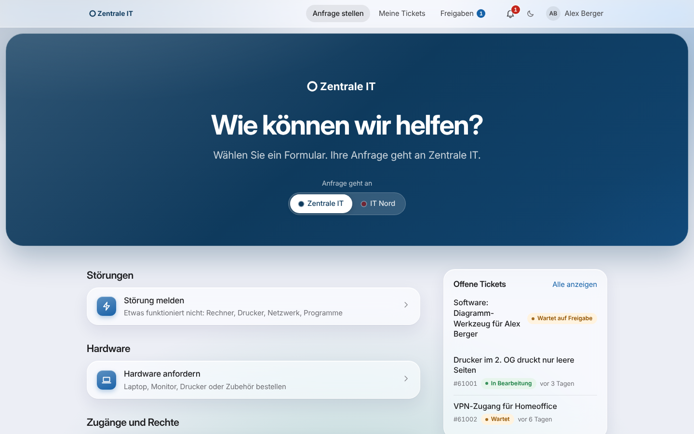

# Zammad Service-Portal

Self-Service-Portal für IT-Abteilungen mit einem oder mehreren Zammad-Systemen: Mitarbeitende melden sich mit ihrem Microsoft-Konto an, wählen das Ticketsystem, füllen ein passendes Formular aus und sehen ihre offenen Tickets. Das Portal legt Tickets **ausschließlich über die Zammad-API** an und liest sie dort. Es verschickt selbst keine E-Mails – Eingangsbestätigungen und Antworten kommen wie gewohnt aus Zammad.



## Was das Portal kann

| Bereich | Funktionen |
| --- | --- |
| Anmeldung | Microsoft Entra ID (SSO, mehrere Tenants mit Vertrauensstellung), lokale Konten mit generiertem Passwort für Start und Notfall, Zwei-Faktor-Anmeldung (Authenticator-App) für lokale Admins |
| Mehrere Ticketsysteme | Beliebig viele Zammad-Instanzen; Benutzer wählen, wohin die Anfrage geht. Pro System eigene Formulare, Vorlagen, Übersichten, Farben und Logos |
| Formulare | Editor mit Drag-and-Drop, Live-Vorschau, Pflichtfeldern, Prüfmustern, Sichtbarkeitsregeln, Feldern nur für bestimmte Gruppen, Datei-Uploads, Versionierung und optionalem Vier-Augen-Prinzip |
| Zammad-Objekte | Ticket-Attribute aus dem Zammad-Objekt-Manager (z. B. `sec_status` als tree_select) werden gezielt freigegeben – inklusive Auswahl der erlaubten Werte – und erscheinen als Auswahlfelder |
| Tickets | Ticket wird im Namen des Benutzers angelegt (`X-On-Behalf-Of`), bekommt einen Portal-Tag, Gruppe, Priorität, Tags und Attribute aus dem Formular. Mitarbeitende sehen ihre Tickets in konfigurierbaren Übersichten, lesen den Verlauf ohne interne Notizen und können antworten |
| Verwaltung | Rollen und Rechte global oder pro Ticketsystem (Entra-Gruppen, App-Rollen, Personen), Benutzerverwaltung, Audit-Log mit Hash-Kette, Zustellungsübersicht, Updates per Klick mit automatischem Rollback |
| Oberfläche | Ruhiges, helles Design mit großer Farbfläche je Ticketsystem, dunkles Design per Schalter, für Handy und Desktop, barrierearm (Tastatur, Screenreader, Kontrastprüfung) |
| Betrieb | Docker-Compose-Stack oder direkt auf Debian/Ubuntu (systemd), Installation mit einem Befehl, nur intern erreichbar, Caddy mit TLS, ClamAV-Virenscan, verschlüsselte Ablage, keine npm-Laufzeitabhängigkeiten |

## Installation mit einem Befehl

Auf einem Linux-Server (Debian oder Ubuntu empfohlen):

```bash
curl -fsSL https://raw.githubusercontent.com/Hundexe/Zammad-Service-Portal/main/setup.sh | sudo bash
```

Das Skript fragt, wie das Portal laufen soll, und erledigt den Rest:

| Variante | Für wen | Was passiert |
| --- | --- | --- |
| **1) Docker** | Server mit oder ohne Docker | installiert Docker bei Bedarf, baut und startet den Compose-Stack |
| **2) Direkt auf Debian/Ubuntu** | ohne Docker | installiert Node.js, Caddy und optional ClamAV, richtet systemd-Dienste ein |
| **3) Nur ausprobieren** | zum Anschauen | startet eine Demo mit Beispieldaten, simuliertem Zammad und simuliertem Microsoft-Login; nichts wird dauerhaft eingerichtet |

Danach fragt es Hostname oder IP, Ports (Vorschlag eines freien Ports, falls 443/80 belegt sind), Virenscanner und optional die Microsoft-Anmeldung ab und legt den ersten Admin mit generiertem Passwort an. Ohne Menü: `… | sudo bash -s -- --docker` (bzw. `--debian`, `--demo`). Erneut ausführen aktualisiert das Portal; Einstellungen und Daten bleiben.

**Nur ansehen, ohne Server:** Mit Node.js ≥ 22.18 auf dem eigenen Rechner reicht

```bash
git clone https://github.com/Hundexe/Zammad-Service-Portal.git && cd Zammad-Service-Portal && npm run demo
```

und dann <http://localhost:3000> öffnen („Mit Microsoft anmelden“ meldet ohne Passwort als Demo-Admin an).

Die ausführliche Anleitung mit Entra-App-Registrierung, Zammad-API-Benutzer und Zertifikaten steht in [docs/INSTALLATION.md](docs/INSTALLATION.md).

## Dokumentation

| Dokument | Inhalt |
| --- | --- |
| [Installation](docs/INSTALLATION.md) | Ein Befehl oder Schritt für Schritt, mit Docker oder direkt auf Debian |
| [Bedienung](docs/BEDIENUNG.md) | Portal für Mitarbeitende und Verwaltung, mit Screenshots |
| [Architektur](docs/ARCHITEKTUR.md) | Aufbau, Datenfluss, Datenmodell, Zammad-Anbindung |
| [Sicherheit](docs/SICHERHEIT.md) | Schutzmaßnahmen, Bedrohungsmodell, Abgleich mit OWASP |
| [Penetrationstest](docs/PENTEST.md) | Vorgehen, Werkzeuge, Ergebnisse und behobene Funde |
| [Updates](docs/UPDATES.md) | Releases signieren, Updates aus der Oberfläche, Rollback |
| [Betrieb](docs/BETRIEB.md) | Sicherung, Wiederherstellung, Logs, Störungen beheben |
| [Entwicklung](docs/ENTWICKLUNG.md) | Lokale Demo, Tests, Screenshots |

## Technik in einem Satz

TypeScript auf Node.js 24 ohne externe Laufzeitpakete (HTTP, Krypto, SQLite und TypeScript bringt Node mit), Frontend ohne Framework mit strenger Content-Security-Policy, Datenhaltung in SQLite. Das spart Angriffsfläche durch fremde Pakete und hält den Stack klein.

## Tests

```bash
npm test             # 127 Tests: Funktionen, Sicherheit, Updater
npm run typecheck
```
