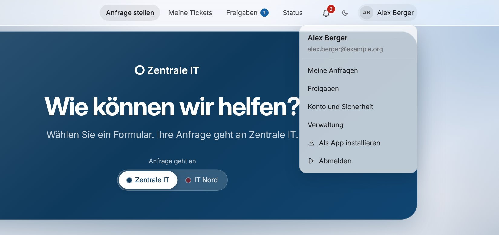
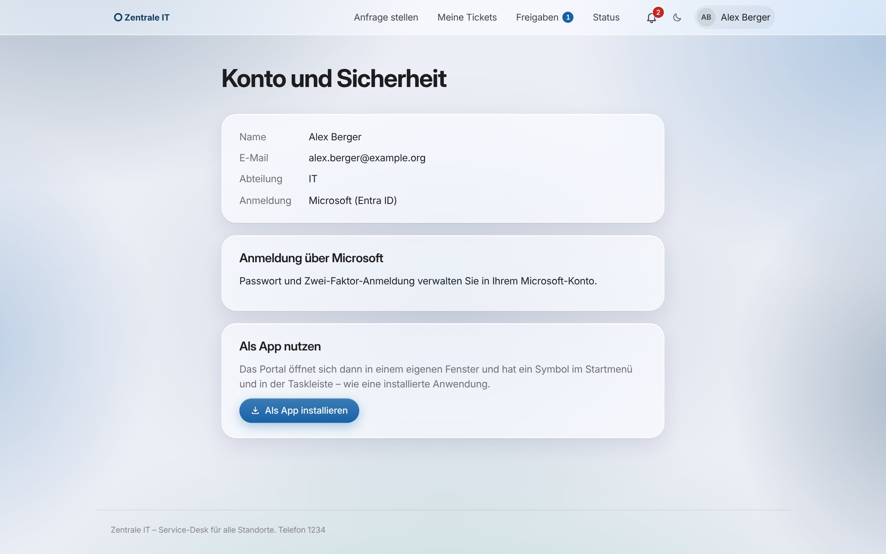
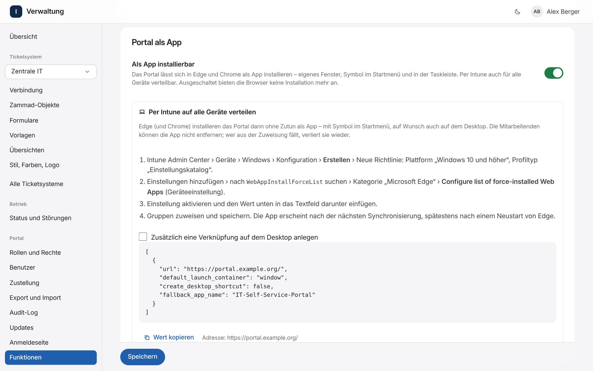

# Portal als App (PWA) und Verteilung per Intune

Das Self-Service-Portal lässt sich wie eine Anwendung installieren – ähnlich wie Spotify oder Teams im Browser. Es öffnet sich dann in einem **eigenen Fenster** ohne Adressleiste, hat ein **Symbol im Startmenü, in der Taskleiste oder im Dock** und eine Titelleiste in den Farben des Portals. Technisch ist das eine *Progressive Web App* (PWA): Es gibt keine zusätzliche Software, keinen App-Store und nichts zu aktualisieren – die App **ist** das Portal und ist nach jedem Portal-Update sofort auf dem neuen Stand.

Für die IT besonders praktisch: Über **Microsoft Intune** (oder eine Gruppenrichtlinie) installiert Edge das Portal auf allen verwalteten Geräten automatisch.

## Inhalt

- [Was die App kann](#was-die-app-kann)
- [Einschalten](#einschalten)
- [Selbst installieren](#selbst-installieren)
- [Per Intune verteilen](#per-intune-verteilen)
- [Ohne Intune: Gruppenrichtlinie oder Registry](#ohne-intune-gruppenrichtlinie-oder-registry)
- [Handys und Tablets](#handys-und-tablets)
- [Sicherheit](#sicherheit)
- [Fehlersuche](#fehlersuche)

## Was die App kann

| | |
| --- | --- |
| Fenster | eigenes Fenster ohne Adressleiste, Titelleiste in der Farbe der Farbfläche |
| Symbol | Startmenü, Taskleiste, Dock oder Home-Bildschirm; Rechtsklick auf das Symbol bietet „Anfrage stellen“, „Meine Anfragen“ und – wenn eingeschaltet – „Status“ |
| Anmeldung | wie im Browser über Microsoft. Edge und Chrome teilen die Anmeldung mit dem Browserprofil – mit Single Sign-on auf verwalteten Geräten meist ganz ohne Eingabe |
| Links | ein Klick auf einen Portal-Link (z. B. in einer Mail) öffnet das vorhandene App-Fenster statt eines zweiten |
| Benachrichtigungen | wie im Browser unter der Glocke (keine Push-Nachrichten) |
| Ohne Netz | eine verständliche Seite „Keine Verbindung zum Portal“ mit „Erneut versuchen“ statt der Fehlerseite des Browsers. Daten werden **nicht** auf dem Gerät gespeichert |
| Updates | kommen mit jedem Portal-Update automatisch |

 

## Einschalten

**Verwaltung › Funktionen › Portal als App › Als App installierbar** (Recht „Globale Einstellungen ändern“). Die Funktion ist **standardmäßig an**.

- **Name** der App ist der Name aus **Stil, Farben, Logo** der globalen Gestaltung (z. B. „IT-Self-Service-Portal“). Für Startbildschirm und Taskleiste wird er bei Bedarf an einer Wortgrenze auf 15 Zeichen gekürzt.
- **Symbol:** Das Portal erzeugt es selbst – drei Zeilen in der Schriftfarbe auf der Farbe der Farbfläche, in allen nötigen Größen und als „maskable“ Variante für runde Symbole auf Android. Ist unter **Stil, Farben, Logo** ein eigenes **Favicon als SVG** oder als quadratisches **PNG ab 192 Pixeln** hinterlegt, wird es zusätzlich angeboten. Ändern sich die Farben, holen sich die Browser das neue Symbol.
- **Voraussetzung:** HTTPS (im Produktivbetrieb immer gegeben).

Ausgeschaltet liefert das Portal kein Manifest mehr aus, die Browser bieten keine Installation mehr an, und der Service Worker meldet sich beim nächsten Aufruf ab. Bereits installierte Apps öffnen weiter einfach das Portal im eigenen Fenster; entfernen lassen sie sich wie jede App (bzw. per Intune, siehe unten).



## Selbst installieren

Mitarbeitende finden **„Als App installieren“** im Menü unter ihrem Namen oben rechts, sobald der Browser die Installation anbietet, und eine Anleitung unter **Konto und Sicherheit › Als App nutzen**.

| Browser | So geht es |
| --- | --- |
| **Edge** (Windows, macOS) | Menü unter dem Namen › **Als App installieren** – oder in Edge: Menü „…“ › **Apps** › **Diese Website als App installieren** |
| **Chrome** (Windows, macOS, Linux, ChromeOS) | Menü unter dem Namen › **Als App installieren** – oder das Symbol „Installieren“ rechts in der Adressleiste |
| **Safari** (iPhone, iPad) | **Teilen** › **Zum Home-Bildschirm** |
| **Safari** (macOS ab Sonoma) | **Ablage** › **Zum Dock hinzufügen** |
| **Chrome** (Android) | Menü „⋮“ › **App installieren** bzw. **Zum Startbildschirm hinzufügen** |
| **Firefox** | installiert keine Web-Apps – bitte Edge oder Chrome verwenden |

Deinstallieren: in der App oben rechts „…“ › **App deinstallieren**, oder wie jede andere App über Windows-Einstellungen bzw. das Startmenü.

## Per Intune verteilen

Edge und Chrome kennen die Richtlinie **`WebAppInstallForceList`** („Configure list of force-installed Web Apps“): Alle Web-Apps in dieser Liste werden ohne Zutun installiert. Die Mitarbeitenden können sie nicht entfernen; fällt ein Gerät oder eine Person aus der Zuweisung, verschwindet die App wieder.

**Den fertigen Wert gibt es in der Verwaltung** unter **Funktionen › Portal als App › Per Intune auf alle Geräte verteilen** – mit der richtigen Adresse und einem Knopf zum Kopieren.

1. **Intune Admin Center** › **Geräte** › **Windows** › **Konfiguration** › **Erstellen** › **Neue Richtlinie**.
2. Plattform **Windows 10 und höher**, Profiltyp **Einstellungskatalog**. Name z. B. „Edge – Self-Service-Portal als App“.
3. **Einstellungen hinzufügen** › nach `WebAppInstallForceList` suchen › Kategorie **Microsoft Edge** › **Configure list of force-installed Web Apps** (die Geräteeinstellung).
4. Einstellung **aktivieren** und den Wert aus der Verwaltung in das Textfeld einfügen:

   ```json
   [
     {
       "url": "https://portal.example.org/",
       "default_launch_container": "window",
       "create_desktop_shortcut": false,
       "fallback_app_name": "IT-Self-Service-Portal"
     }
   ]
   ```

5. **Zuweisungen:** Geräte- oder Benutzergruppen wählen, dann **Erstellen**.

Nach der nächsten Synchronisierung des Geräts (spätestens nach einem Neustart von Edge) erscheint die App im Startmenü. Mit `"create_desktop_shortcut": true` (Kästchen „Zusätzlich eine Verknüpfung auf dem Desktop anlegen“ in der Verwaltung) gibt es zusätzlich ein Symbol auf dem Desktop.

| Feld | Bedeutung |
| --- | --- |
| `url` | Adresse des Portals (Startseite). Muss genau die Adresse sein, unter der das Portal läuft |
| `default_launch_container` | `window` = eigenes App-Fenster, `tab` = Tab im Browser |
| `create_desktop_shortcut` | zusätzlich eine Verknüpfung auf dem Desktop |
| `fallback_app_name` | Name, bis Edge das Manifest des Portals geladen hat |

**Google Chrome:** Dieselbe Einstellung gibt es im Einstellungskatalog unter der Kategorie **Google Chrome** – gleicher Wert.

**macOS:** Für Edge auf dem Mac dieselbe Richtlinie als Einstellungsdatei (Konfigurationsprofil mit der Vorlage „Einstellungsdatei“ bzw. „Preference file“, Domäne `com.microsoft.Edge`):

```xml
<key>WebAppInstallForceList</key>
<array>
  <dict>
    <key>url</key><string>https://portal.example.org/</string>
    <key>default_launch_container</key><string>window</string>
  </dict>
</array>
```

**Prüfen:** Auf einem Zielgerät in Edge `edge://policy` öffnen (die Richtlinie steht dort mit Status „OK“) und `edge://apps` – dort steht das Portal als installierte App.

## Ohne Intune: Gruppenrichtlinie oder Registry

- **Gruppenrichtlinie:** Administrative Vorlagen › Microsoft Edge › **Configure list of force-installed Web Apps** (in deutschen Vorlagen übersetzt), Wert wie oben. Dafür werden die Edge-Vorlagen (`msedge.admx`) benötigt.
- **Registry** (z. B. per Skript), Typ `REG_SZ`, Inhalt ist die JSON-Liste in einer Zeile:

  ```powershell
  $key = 'HKLM:\SOFTWARE\Policies\Microsoft\Edge'
  New-Item -Path $key -Force | Out-Null
  Set-ItemProperty -Path $key -Name 'WebAppInstallForceList' -Value '[{"url":"https://portal.example.org/","default_launch_container":"window"}]'
  ```

  Für Chrome entsprechend unter `HKLM:\SOFTWARE\Policies\Google\Chrome`.

## Handys und Tablets

Die Richtlinie gilt nur für Edge und Chrome auf Windows, macOS und Linux. Für verwaltete Handys und Tablets legt man in Intune eine App vom Typ **Weblink** mit der Adresse des Portals an (Apps › iOS/iPadOS bzw. Android › Hinzufügen › Weblink) und weist sie zu – das Portal erscheint dann als Symbol auf dem Home-Bildschirm. Mitarbeitende können es auf iPhone und iPad auch selbst über **Teilen › Zum Home-Bildschirm** hinzufügen.

## Sicherheit

- **Keine Daten auf dem Gerät:** Der Service Worker (`/sw.js`) speichert **nichts** zwischen – keine Seiten, keine Tickets, keine Anhänge. Er fängt nur Seitenaufrufe ab, um ohne Netz die Hinweisseite „Keine Verbindung“ zu zeigen. Aufrufe unter `/api/` – also Anmeldung, Daten und Weiterleitungen zu Microsoft – lässt er unberührt. Bei jeder Aktivierung leert er vorsorglich alle Zwischenspeicher des Portals.
- **Gleiche Schutzmaßnahmen wie im Browser:** Die App ist der Browser – Sitzungs-Cookies, CSRF-Schutz, Content-Security-Policy, Abmeldung nach Inaktivität und bedingter Zugriff von Microsoft gelten unverändert. Die CSP erlaubt Service Worker nur vom eigenen Server (`worker-src 'self'`), das Manifest nur vom eigenen Server (`manifest-src 'self'`).
- **Öffentlich, aber ohne Inhalt:** Manifest (`/api/app/manifest`) und Symbole (`/api/app/icon/…`) sind ohne Anmeldung abrufbar – das müssen sie, damit Edge die App auch vor der ersten Anmeldung installieren kann. Sie enthalten nur Name und Farben des Portals, die ohnehin auf der Anmeldeseite stehen.
- **Ausschaltbar:** Mit dem Schalter in **Funktionen** ist alles abgeschaltet (Manifest und Symbole antworten mit 404, der Service Worker meldet sich ab).

## Fehlersuche

| Problem | Ursache und Lösung |
| --- | --- |
| Kein „Als App installieren“ im Menü | Die App ist schon installiert, der Browser bietet keine Installation an (Firefox, Safari – siehe [Selbst installieren](#selbst-installieren)) oder die Funktion ist ausgeschaltet. Im Menü erscheint der Eintrag nur, wenn Edge oder Chrome die Installation gerade anbieten |
| Edge zeigt das Symbol in der Adressleiste nicht | Portal ohne HTTPS aufgerufen oder Funktion aus. Prüfen: `https://<portal>/api/app/manifest` muss JSON liefern |
| Intune: App erscheint nicht | `edge://policy` → steht `WebAppInstallForceList` dort? „Richtlinien neu laden“ klicken, Edge neu starten. Das Gerät muss das Portal zum Installieren erreichen können (ggf. VPN) |
| Intune: Status „Fehler“ in `edge://policy` | Der Wert ist kein gültiges JSON – den Wert aus der Verwaltung unverändert einfügen |
| Falscher Name oder altes Symbol | Name und Farben unter **Stil, Farben, Logo** (global) ändern. Edge und Chrome übernehmen Änderungen beim nächsten Start der App, das kann bis zu einem Tag dauern |
| App öffnet Microsoft-Anmeldung in einem Fenster mit Adressleiste | So gewollt: Seiten außerhalb des Portals zeigt die App mit Adresse an, damit erkennbar ist, wo man sich anmeldet. Danach geht es im App-Fenster weiter |
