# Bedienung

- [Für Mitarbeitende](#für-mitarbeitende)
- [Für die Verwaltung](#für-die-verwaltung)

---

## Für Mitarbeitende

### Anmelden

Portal öffnen und **Mit Microsoft anmelden** wählen. Es gilt dasselbe Konto wie für Outlook und Teams. Ein eigenes Passwort für das Portal gibt es nicht.

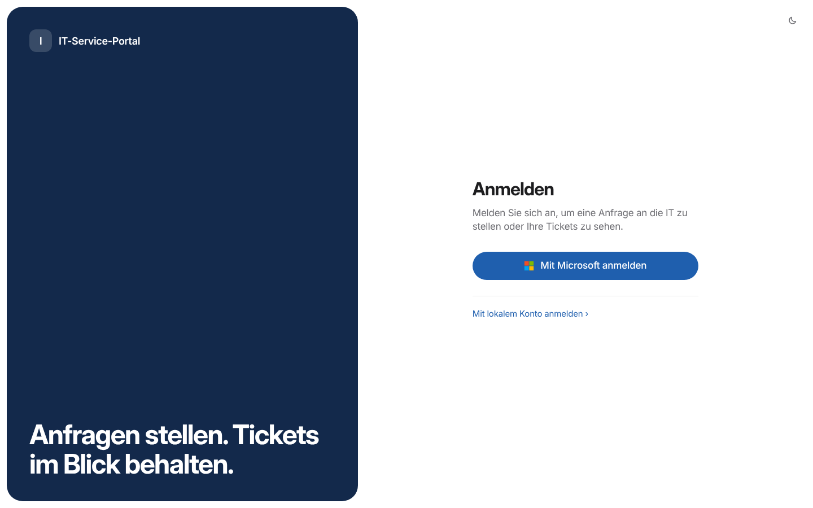

### Anfrage stellen

1. In der großen Farbfläche unter **Anfrage geht an** das Ticketsystem wählen. Farbe und Logo zeigen, wohin die Anfrage geht. Wer nur ein Ticketsystem nutzen darf, sieht keine Auswahl.
2. Formular wählen, z. B. **Störung melden** oder **Hardware anfordern**.

   

   Beim zweiten Ticketsystem wechseln Farben und Formulare:

   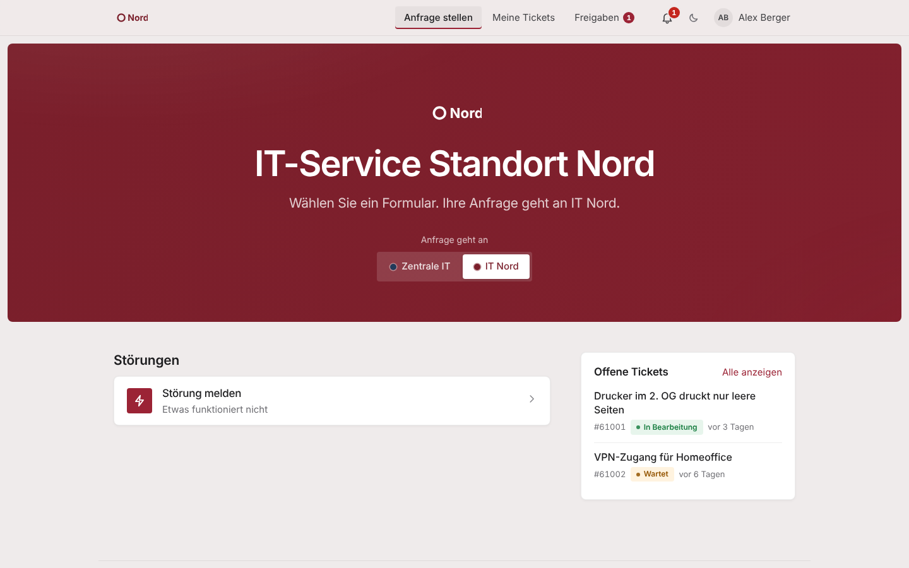

3. Formular ausfüllen. Pflichtfelder sind mit * markiert. Manche Felder erscheinen erst, wenn sie gebraucht werden (z. B. „Welches Programm?“ nur bei „Programm“).

   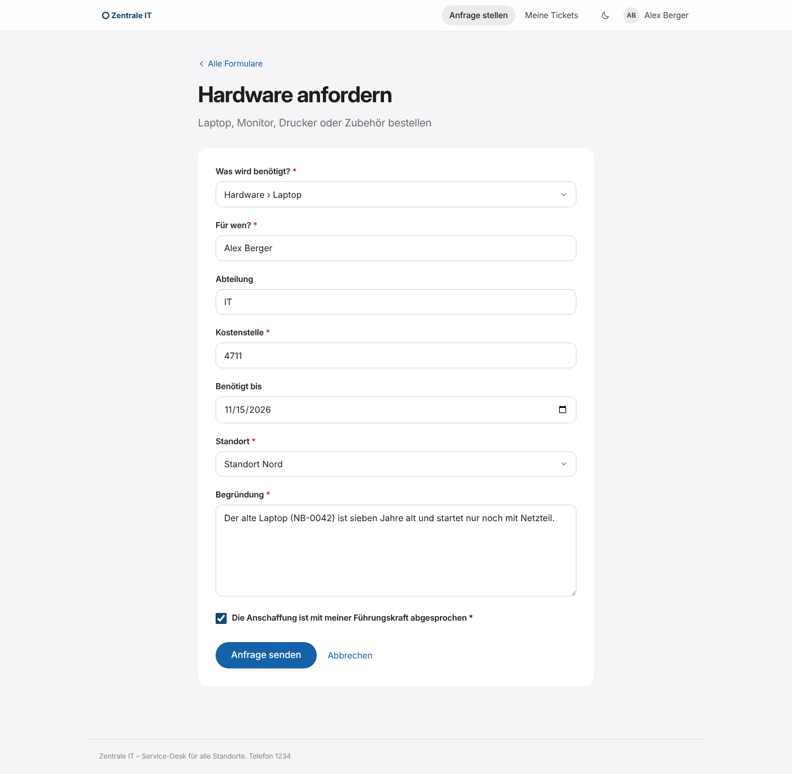

   Fehlt etwas, markiert das Portal die Felder direkt:

   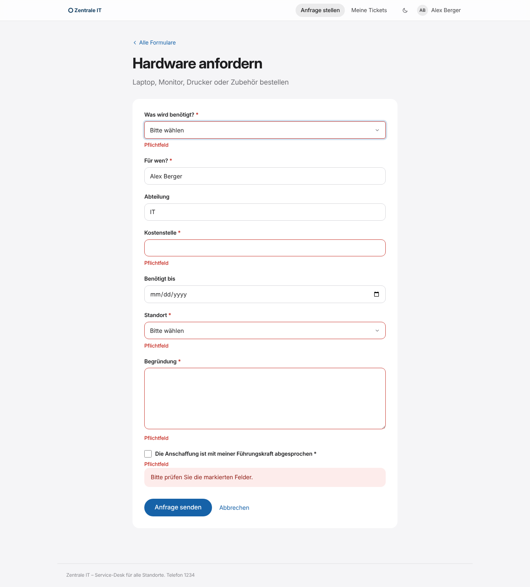

4. **Anfrage senden.** Die Eingangsbestätigung mit Ticketnummer kommt per E-Mail von Zammad.

   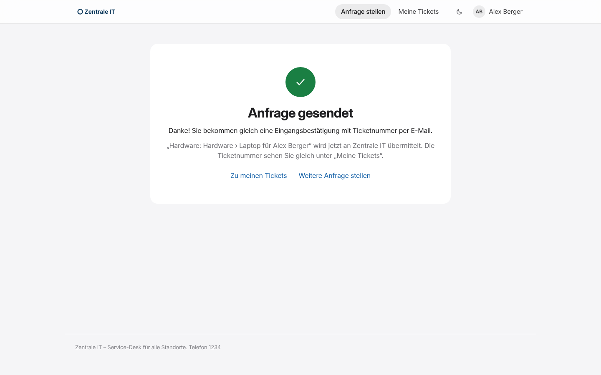

**Dateien:** Screenshots, PDFs, Office-Dokumente oder Textdateien lassen sich anhängen (je Formular festgelegt, meist bis 10 MB). Jede Datei wird auf Viren geprüft. Programme, Skripte und HTML-Dateien werden abgelehnt.

### Meine Tickets

Unter **Meine Tickets** stehen alle eigenen Tickets, sortiert nach letzter Änderung, mit Reitern wie „Offene Tickets“ und „Erledigt“. Was noch nicht an Zammad übermittelt wurde, steht oben unter „Noch nicht übermittelt“.

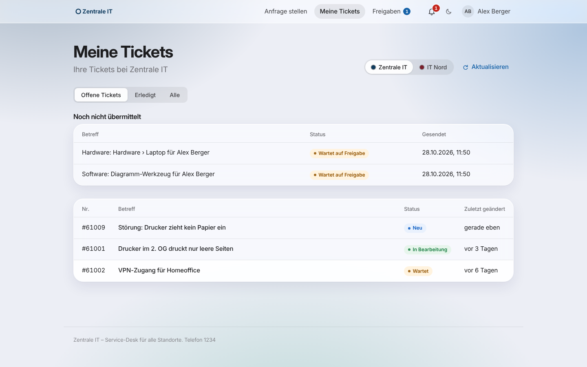

Ein Klick öffnet den Verlauf mit allen Antworten der IT. Interne Notizen der IT sind nicht sichtbar. Unten lässt sich antworten, auch mit Anhang. Eine Antwort auf ein erledigtes Ticket öffnet es in der Regel wieder.

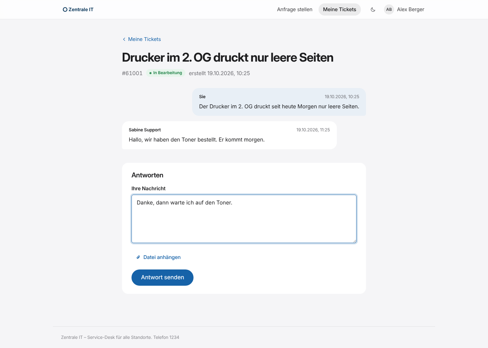

### Auf dem Handy

Das Portal passt sich an kleine Bildschirme an.

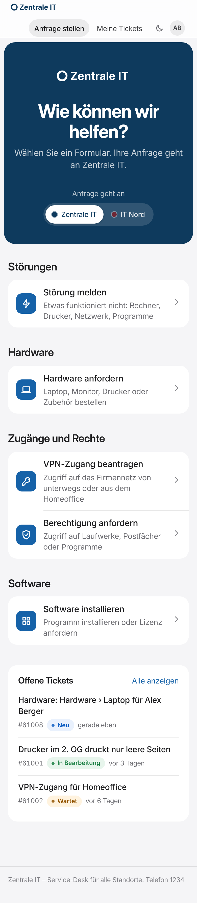 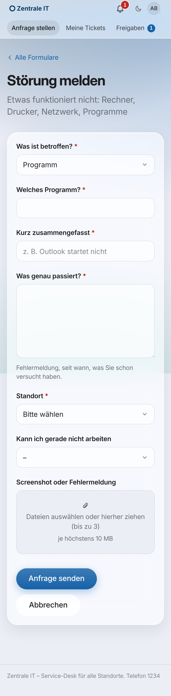

### Helles und dunkles Design

Das Mond-Symbol oben rechts schaltet auf das dunkle Design um, die Sonne zurück auf hell. Ohne eigene Wahl folgt das Portal der Einstellung von Windows, macOS oder dem Handy. Die Wahl wird nur im eigenen Browser gespeichert.

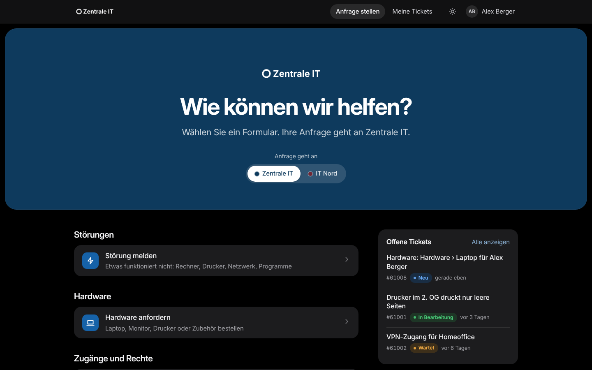 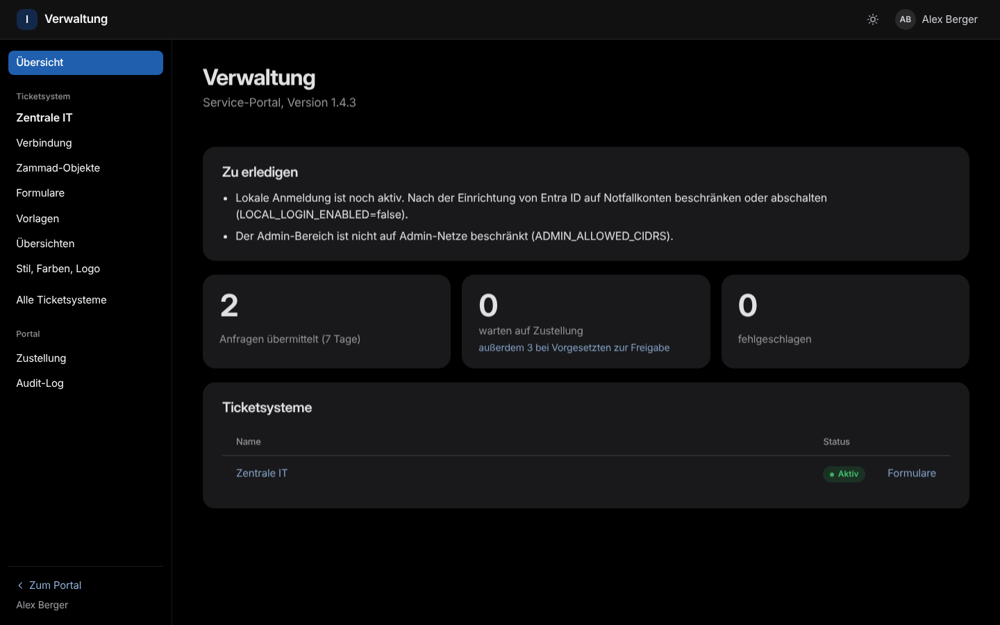

### Konto

Unter dem Namen oben rechts: **Meine Anfragen** (alles, was über das Portal gesendet wurde), **Konto und Sicherheit** und **Abmelden**.

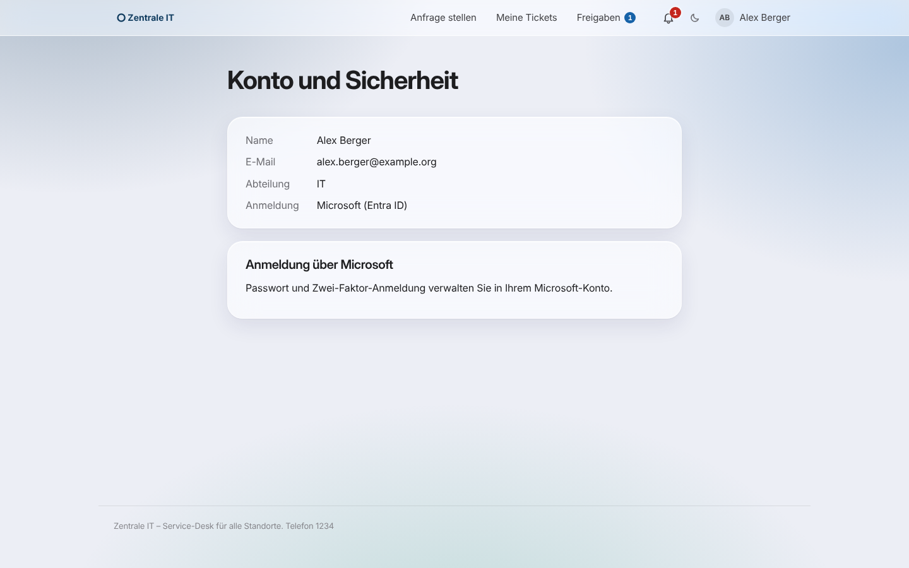

---

## Für die Verwaltung

Die Verwaltung erreichen alle mit einer Admin-Rolle über das Menü oben rechts → **Verwaltung**. Links steht oben das Ticketsystem, das gerade bearbeitet wird, darunter die globalen Bereiche.

### Übersicht

Zeigt offene Aufgaben (z. B. Sicherheitshinweise zur Konfiguration), Zahlen zur Zustellung und Versionen, die auf Freigabe warten.

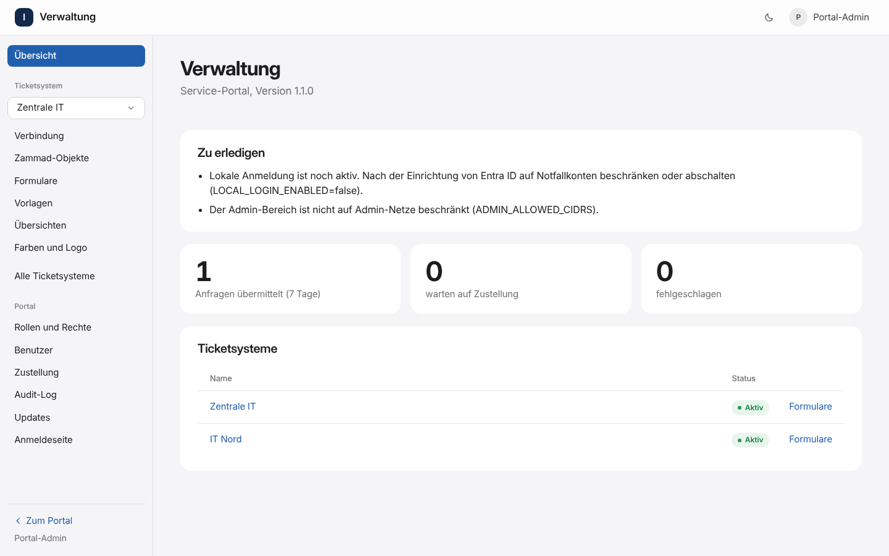

### Ticketsysteme und Verbindung

**Alle Ticketsysteme → Ticketsystem hinzufügen** verbindet eine Zammad-Instanz. Auf der Seite **Verbindung** des Systems stehen:

| Einstellung | Bedeutung |
| --- | --- |
| Zammad-Adresse, API-Token | Zugang; das Token wird verschlüsselt gespeichert und nie wieder angezeigt |
| Tickets anlegen | „Im Namen des Kunden“ (empfohlen): Zammad prüft selbst, welche Tickets ein Kunde sehen darf |
| Standard-Gruppe | Zammad-Gruppe, wenn das Formular keine vorgibt |
| Tag für Portal-Tickets | wird an jedes Ticket gehängt, z. B. für den Trigger der Eingangsbestätigung |
| Status | Aktiv / Wartung (Anfragen werden gesammelt und später zugestellt) / Deaktiviert |
| Sichtbar für Entra-Gruppen | leer = für alle; sonst nur für Mitglieder dieser Gruppen |
| Erlaubte Zammad-Gruppen | nur in diese Gruppen legt das Portal Tickets; Formulare mit anderen Gruppen lassen sich nicht speichern (leer = keine Einschränkung, die Übersicht warnt dann) |
| Namen der Bearbeiter ausblenden | Antworten erscheinen im Portal mit dem Namen des Ticketsystems statt mit dem Namen der Person; E-Mail-Adressen werden nie angezeigt |
| Vier-Augen-Prinzip | Formulare und Branding gehen erst nach Freigabe durch eine zweite Person live |

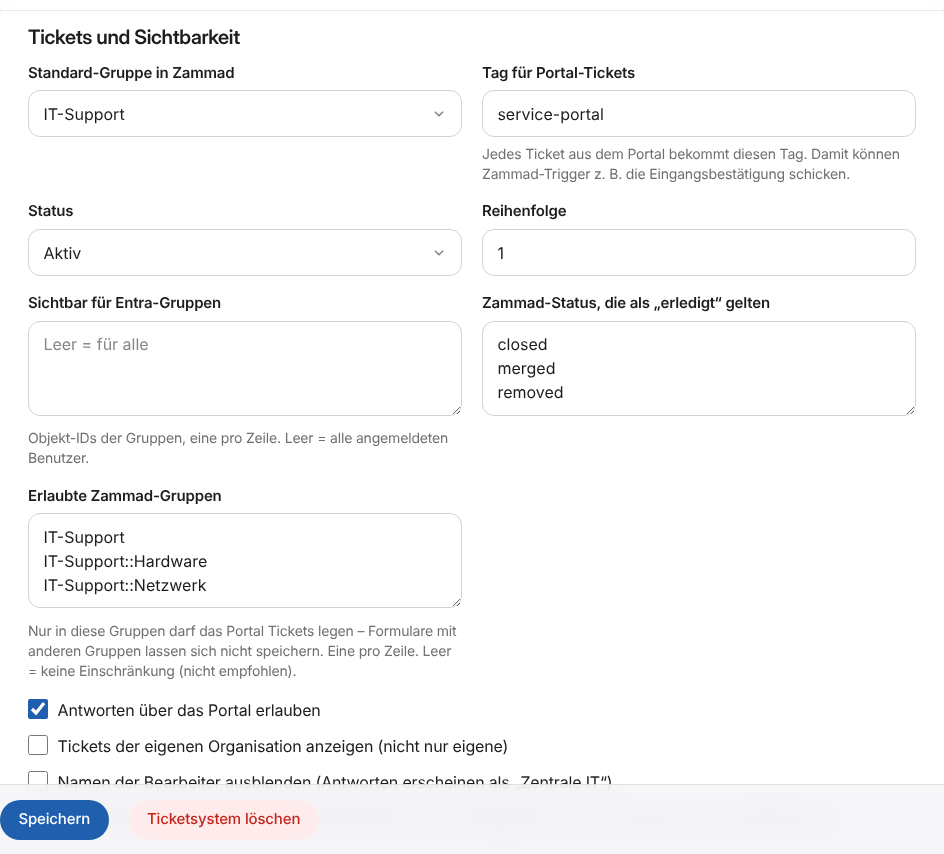

### Zammad-Objekte freigeben

Hier stehen die Ticket-Attribute aus dem Zammad-Objekt-Manager. Ein Häkchen gibt das Attribut für Formulare frei. Bei Auswahlfeldern lässt sich festlegen, welche Werte die Mitarbeitenden wählen dürfen – im Beispiel vom `sec_status` nur die Hardware-Werte. „Alle Werte freigeben“ übernimmt auch Werte, die später in Zammad hinzukommen.

Nicht unterstützte Typen (z. B. Benutzerauswahl) sind ausgegraut. Fehlt die Liste ganz, braucht der API-Benutzer in Zammad das Recht `admin.object`.

### Formulare

**Formulare** listet alle Formulare mit Status. **Kopieren …** übernimmt ein Formular als Entwurf in ein anderes Ticketsystem.

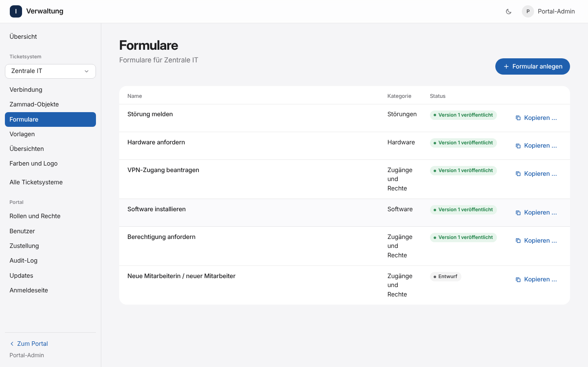

Der Editor hat vier Reiter:

**Felder** – links die Felder (per Ziehen oder mit den Pfeilen sortieren), in der Mitte die Eigenschaften des gewählten Feldes, rechts die Live-Vorschau.

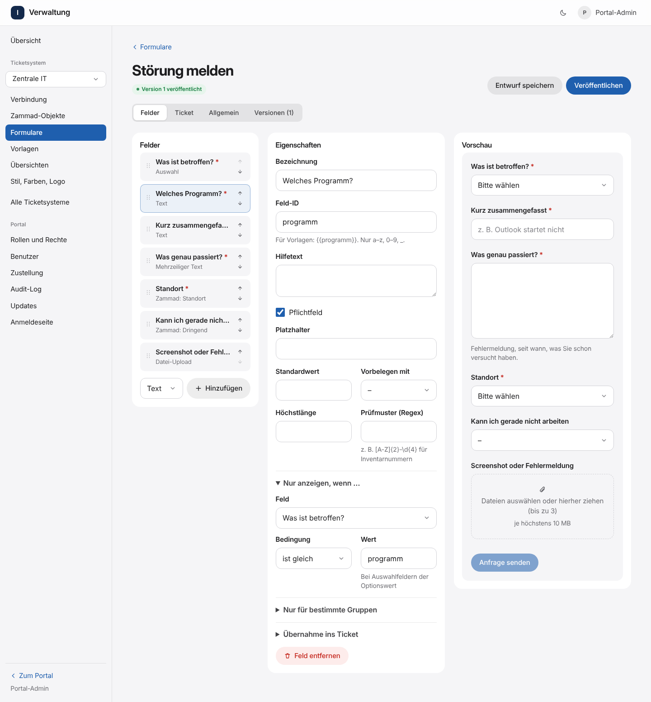

| Eigenschaft | Zweck |
| --- | --- |
| Feldtyp | Text, Mehrzeiliger Text, E-Mail, Zahl, Datum, Kästchen, Auswahl, Mehrfachauswahl, Datei, Hinweistext oder ein freigegebenes **Zammad-Objekt** |
| Feld-ID | Name für Vorlagen, z. B. `{{betreff}}` |
| Pflichtfeld, Platzhalter, Standardwert | Standardwert auch aus dem Profil (Name, E-Mail, Abteilung) |
| Prüfmuster | regulärer Ausdruck, z. B. `\d{4}` für Kostenstellen |
| Nur anzeigen, wenn … | Feld erscheint abhängig von einem anderen Feld |
| Nur für bestimmte Gruppen | Feld nur für Mitglieder bestimmter Entra-Gruppen |
| Übernahme ins Ticket | nur Tickettext, als Tag, bestimmt Gruppe oder Priorität, in ein Zammad-Feld schreiben, oder gar nicht |

**Ticket** – wie das Ticket entsteht: Gruppe, Priorität, zusätzliche Tags, Titel- und Textvorlage, Text nach dem Absenden. `{{alle_felder}}` fügt eine Tabelle mit allen ausgefüllten Feldern ein. Eingaben werden immer sicher maskiert, Vorlagen können keinen Code ausführen.

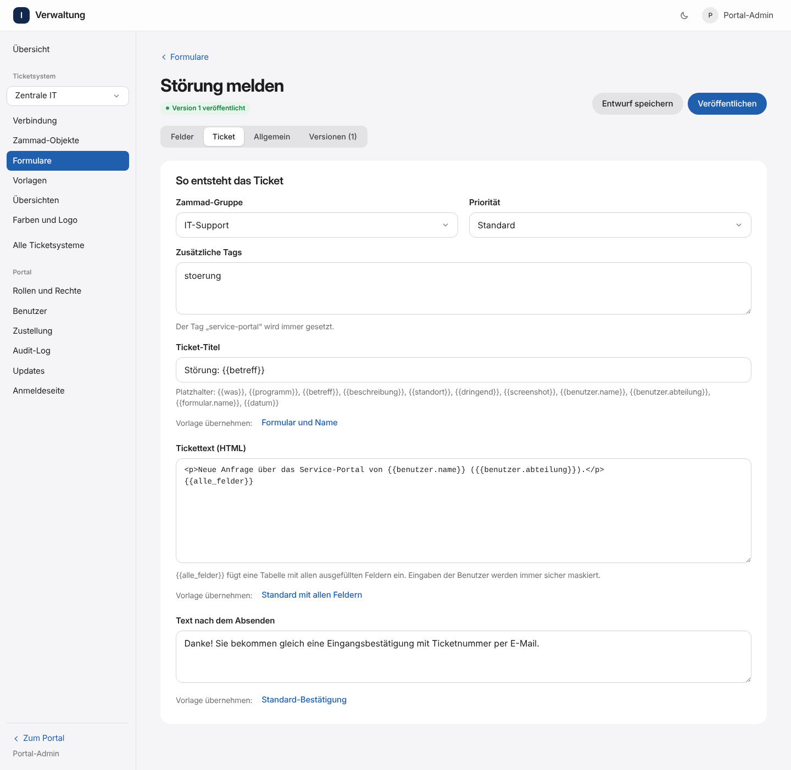

**Allgemein** – Name, Kategorie (gruppiert die Formulare im Portal), Beschreibung, Sichtbarkeit.

**Versionen** – jede Veröffentlichung ist eine Version. Ältere Versionen lassen sich als neuer Entwurf wiederherstellen. Mit Vier-Augen-Prinzip steht hier **Freigeben/Ablehnen** für die zweite Person.

Ablauf: **Entwurf speichern** → **Veröffentlichen** (bzw. **Zur Freigabe senden**). Bis zur Veröffentlichung sehen Mitarbeitende die alte Version.

### Vorlagen und Übersichten

**Vorlagen** sind Textbausteine für Titel, Tickettext und den Text nach dem Absenden. Im Formular-Editor lassen sie sich mit einem Klick übernehmen.

**Übersichten** sind die Reiter unter „Meine Tickets“: Name, welche Tickets (offen, erledigt, alle), Spalten und Sortierung.

### Stil, Farben und Logo

**Stil.** Jedes Ticketsystem kann sein eigenes Erscheinungsbild haben. Wer zwischen zwei Systemen wechselt, sieht sofort, wohin die Anfrage geht. Zur Wahl stehen:

| Stil | Wirkung |
| --- | --- |
| **Standard** | ruhig und hell, große Farbfläche, runde Formen |
| **Glas** | durchscheinende Flächen mit Unschärfe über einem weichen Farbverlauf aus den Farben des Systems – im Stil von Apple |
| **Fluent** | sachlich, kleine Rundungen, Akzentlinien unter Reitern und in der Seitenleiste, Segoe-Schrift unter Windows – im Stil von Microsoft |
| **Material** | getönte Flächen, kräftige Rundungen, runde Symbole, getönte Schaltflächen – im Stil von Google |
| **Kontrast** | schwarze Linien, hoher Kontrast, unterstrichene Links, deutliche Fokus-Rahmen – besonders gut lesbar |

Jeder Stil funktioniert im hellen und im dunklen Design. Die Vorschau im Auswahlfeld zeigt jeden Stil mit den aktuellen Farben.

**Farben.** Unter *Farben* gibt es zwei Möglichkeiten:

- **Farben des Stils:** Jeder Stil bringt eigene, aufeinander abgestimmte Farben mit, die die Kontrastregeln erfüllen. Man muss also nichts einstellen.
- **Eigene Farben:**
  - Ein Klick auf eine fertige Kombination übernimmt deren Farben, zur Wahl stehen Ozean, Wald, Abendrot, Beere, Graphit, Sonne, Minze und Lavendel.
  - Die vier Farben lassen sich auch einzeln wählen.
  - Beim Wechsel auf die Farben des Stils bleiben die eigenen gespeichert.

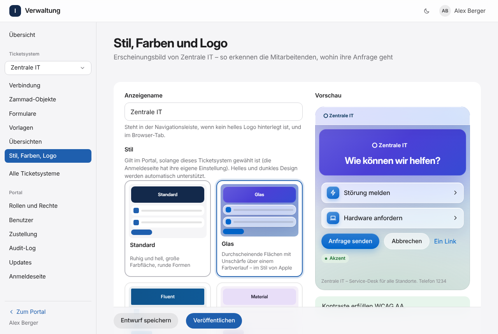

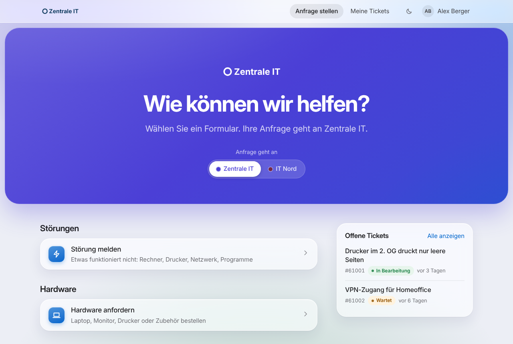 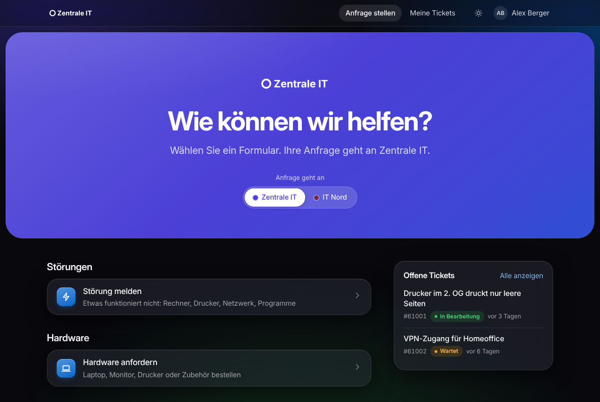
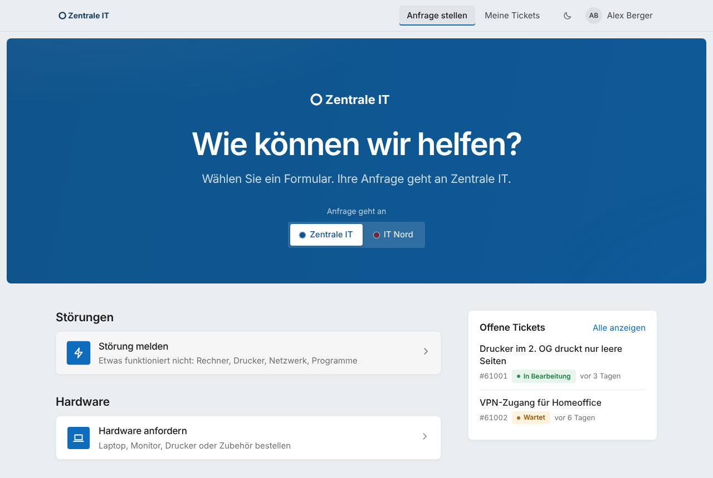 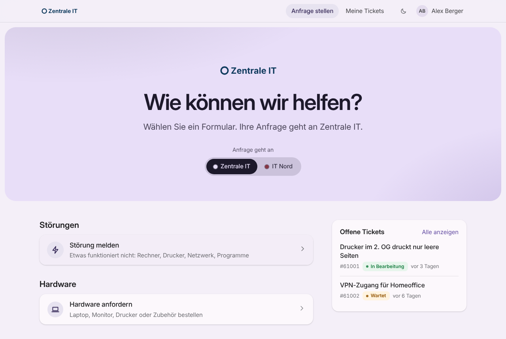
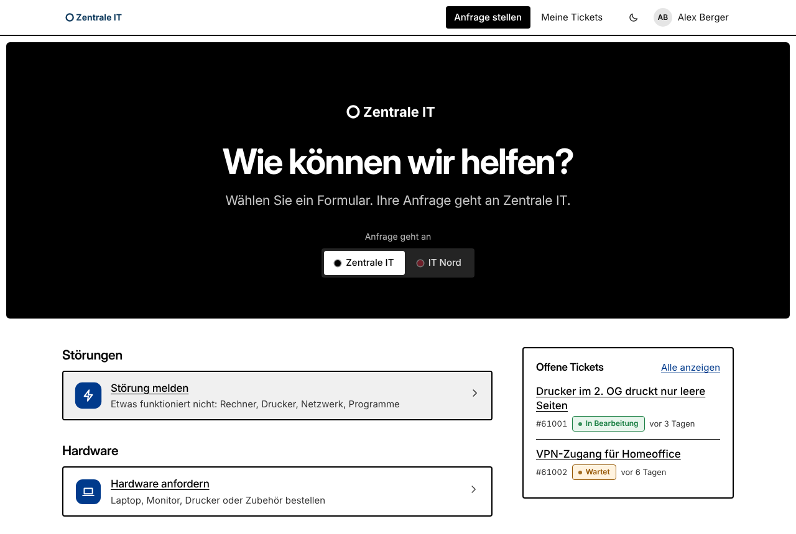 

**Weitere Angaben** pro Ticketsystem: Anzeigename, Farbe der großen Farbfläche (Startseite) und der Schrift darauf, Primärfarbe (Schaltflächen, Links, Symbole) und Akzentfarbe, Logo auf der Farbfläche (wird im dunklen Design auch in der Navigationsleiste verwendet; ist die Farbfläche hell, zum Beispiel bei Material, erscheint dort das Logo für helle Flächen), Logo für die helle Navigationsleiste, Favicon, Begrüßung, Fußzeile, Links zu Impressum und Datenschutz. Die Vorschau rechts zeigt das Ergebnis, die Kontrastprüfung warnt bei schlecht lesbaren Kombinationen (WCAG AA). Logos: PNG, JPEG, WebP oder SVG bis 1 MB; SVGs mit Skripten oder externen Verweisen werden abgelehnt.

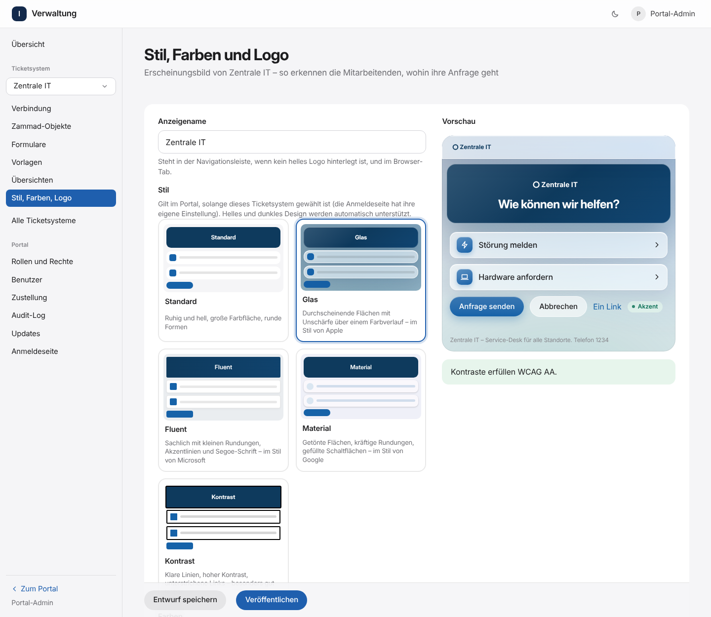

Die Anmeldeseite (vor der Wahl eines Ticketsystems) hat ein eigenes Erscheinungsbild unter **Anmeldeseite**, mit derselben Stil- und Farbauswahl. Die Verwaltung selbst bleibt im Standard-Stil, weil sie alle Ticketsysteme gemeinsam betreut.

### Rollen und Rechte

Rechte werden über **Rollen** vergeben, die einer **Entra-Gruppe**, einer **Person** oder **allen** zugeordnet werden – entweder für **alle Ticketsysteme** oder für **eines**.

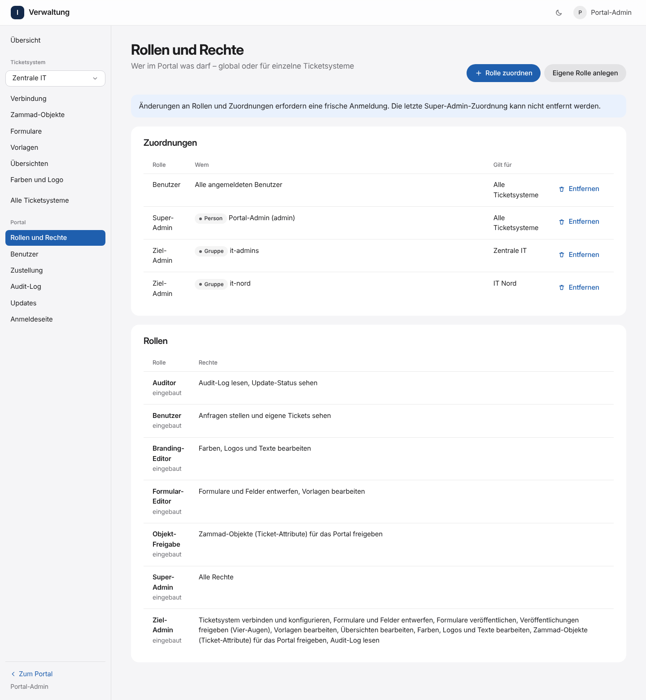

| Eingebaute Rolle | Rechte |
| --- | --- |
| Super-Admin | alles |
| Ziel-Admin | ein Ticketsystem komplett verwalten (Verbindung, Objekte, Formulare inkl. Freigabe, Vorlagen, Übersichten, Branding, Audit-Log) |
| Formular-Editor | Formulare und Vorlagen bearbeiten, nicht veröffentlichen |
| Branding-Editor | Farben, Logos, Texte |
| Objekt-Freigabe | Zammad-Objekte freigeben |
| Auditor | Audit-Log und Update-Status lesen |
| Benutzer | Portal nutzen (standardmäßig allen zugeordnet) |

Eigene Rollen lassen sich aus Einzelrechten zusammenstellen. Rollenverwaltung, Benutzerverwaltung, Updates und globale Einstellungen wirken nur bei einer Zuordnung für **alle** Ticketsysteme. Die letzte Super-Admin-Zuordnung kann nicht entfernt werden.

### Benutzer

Listet lokale Konten und alle Microsoft-Benutzer, die sich schon angemeldet haben. **Lokalen Benutzer anlegen** erzeugt ein Passwort mit 20 Zeichen, das genau einmal angezeigt wird und bei der ersten Anmeldung geändert werden muss.

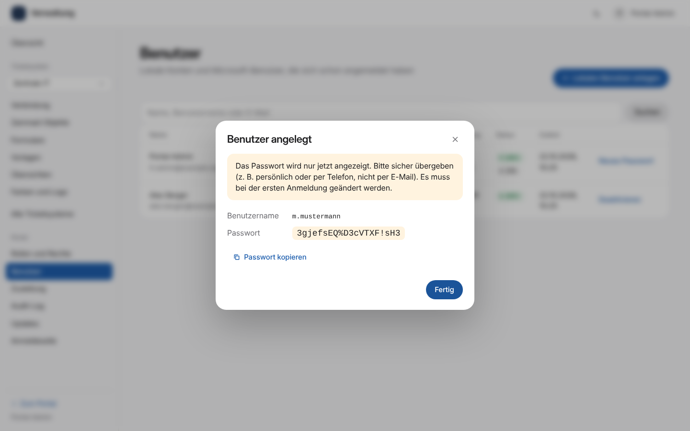

**Neues Passwort** setzt ein neues generiertes Passwort (optional auch die Authenticator-App zurück) und beendet alle Sitzungen des Kontos. Gesperrte Konten (nach 5 Fehlversuchen für 15 Minuten) lassen sich hier entsperren.

### Bestätigung kritischer Aktionen

Für Rollen, Benutzer, Ticketsystem-Zugangsdaten und Updates verlangt das Portal eine frische Anmeldung, wenn die letzte länger als 10 Minuten zurückliegt: bei lokalen Konten Passwort + Code, bei Microsoft-Konten eine erneute Microsoft-Anmeldung.

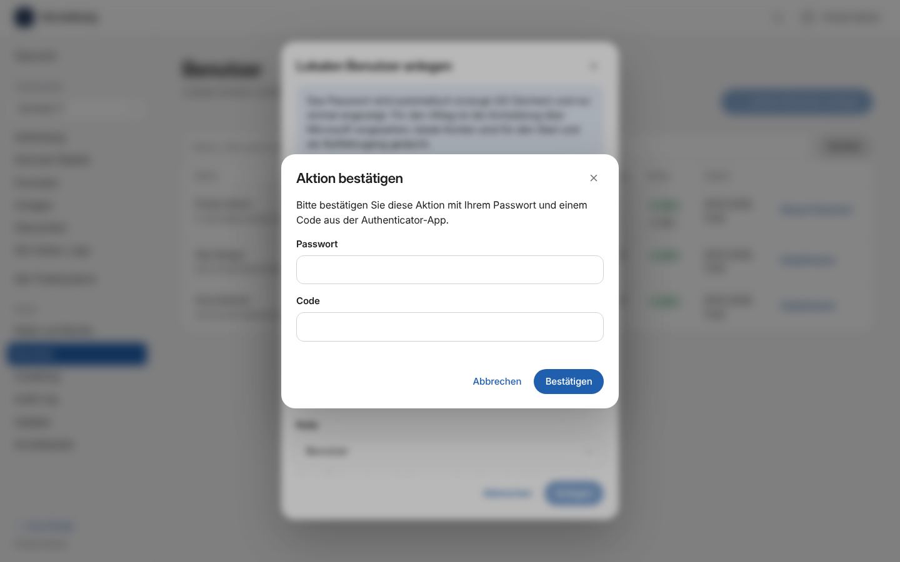

### Zustellung

Alle Anfragen auf dem Weg nach Zammad. Fehlgeschlagene Anfragen (z. B. weil eine Gruppe in Zammad umbenannt wurde) lassen sich nach der Korrektur **erneut senden**.

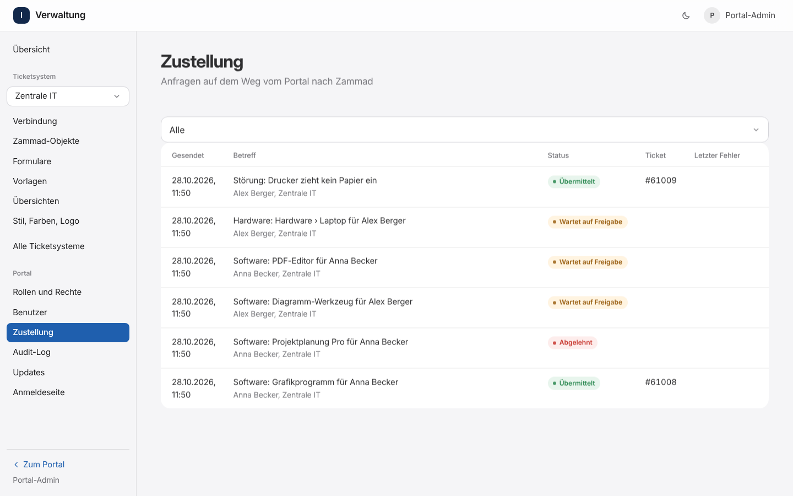

### Audit-Log

Jede Anmeldung und jede Änderung mit Person, Zeit, IP und Vorher/Nachher. Einträge können nicht geändert oder gelöscht werden; **Integrität prüfen** erkennt Manipulationen direkt in der Datenbank. Export als CSV.

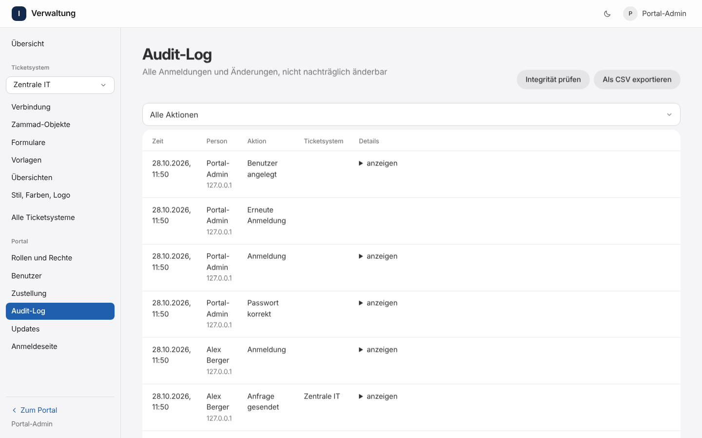

### Updates

Zeigt die installierte und die verfügbaren Versionen. **Auf x.y.z aktualisieren** startet das Update: Signatur prüfen, Datenbank sichern, neue Version bauen und starten. Startet sie nicht sauber, wird automatisch zurückgerollt. Details: [Updates](UPDATES.md).

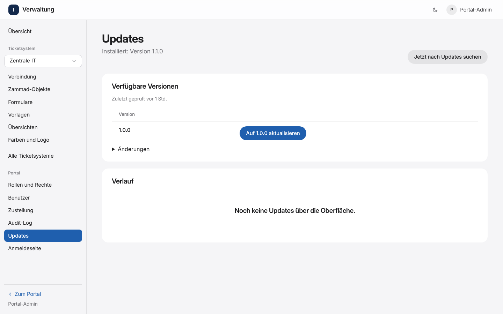
