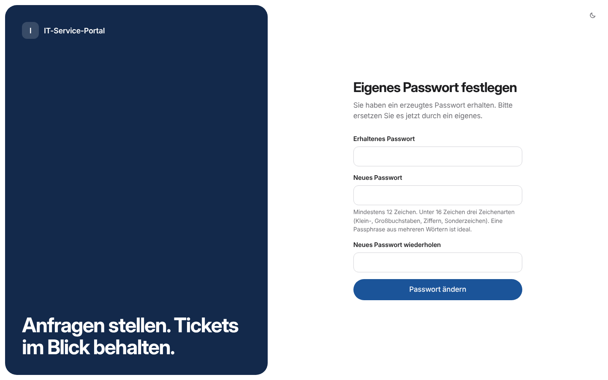
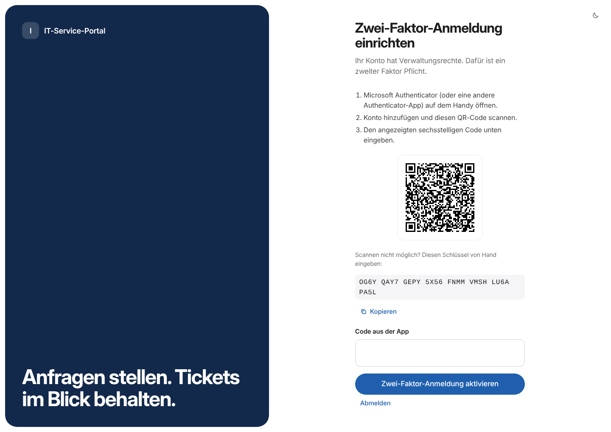
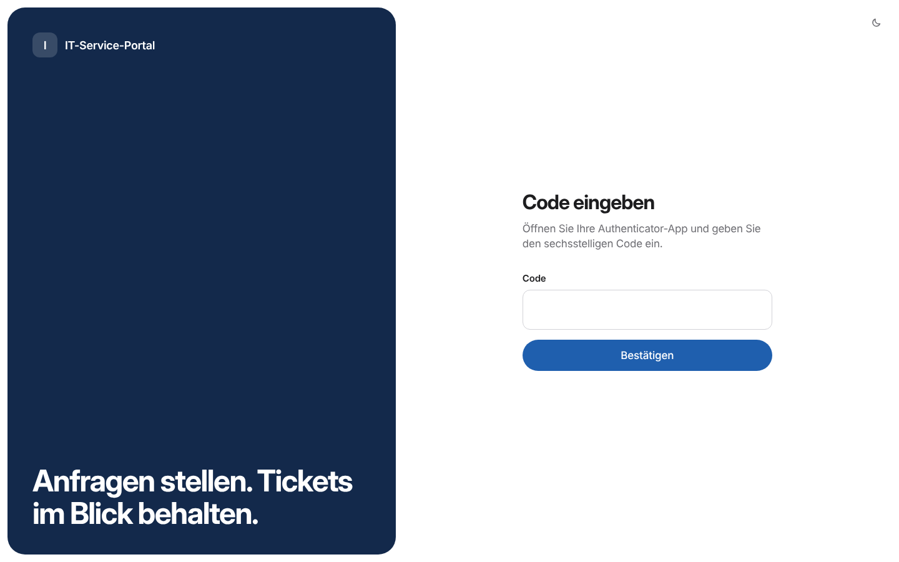
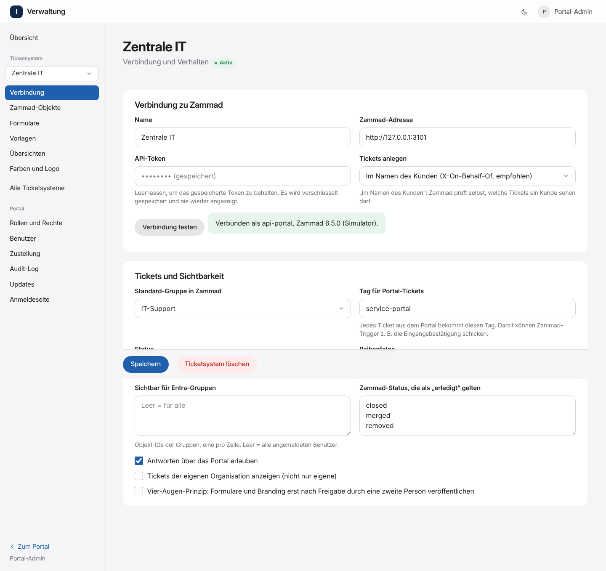
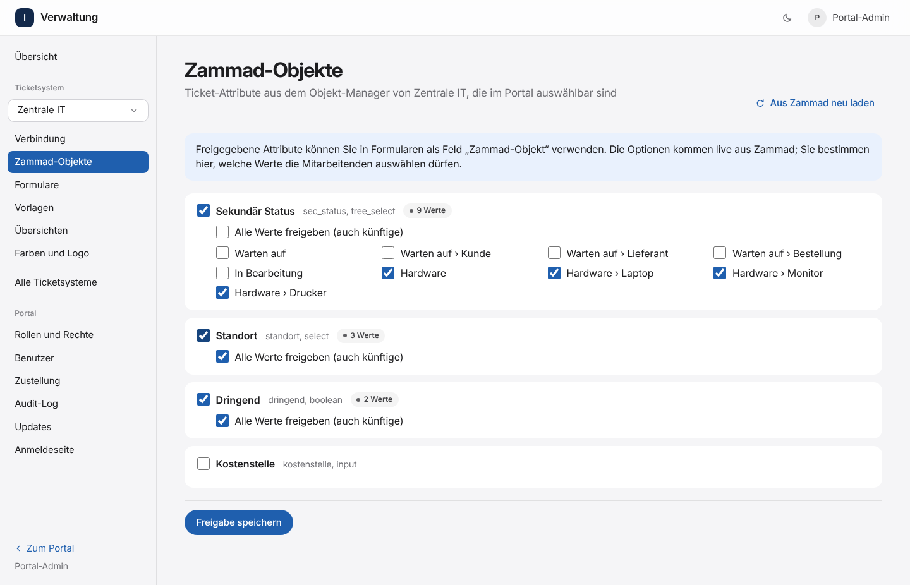

# Installation

Diese Anleitung führt von einer frischen VM auf Proxmox bis zum ersten Ticket aus dem Portal. Docker ist auf der VM bereits installiert.

**Dauer:** etwa eine Stunde, davon das meiste in Entra ID und Zammad.

## Übersicht

1. [VM vorbereiten](#1-vm-vorbereiten)
2. [Betriebsbenutzer anlegen](#2-betriebsbenutzer-anlegen)
3. [Code holen](#3-code-holen)
4. [Microsoft Entra ID: App registrieren](#4-microsoft-entra-id-app-registrieren)
5. [Zammad: API-Benutzer und Token](#5-zammad-api-benutzer-und-token)
6. [Konfiguration und Zertifikat](#6-konfiguration-und-zertifikat)
7. [Installieren und ersten Admin anlegen](#7-installieren-und-ersten-admin-anlegen)
8. [Erste Anmeldung](#8-erste-anmeldung)
9. [Zammad verbinden und Formulare anlegen](#9-zammad-verbinden-und-formulare-anlegen)
10. [Rechte für Entra-Gruppen vergeben](#10-rechte-für-entra-gruppen-vergeben)
11. [Zum Schluss: absichern](#11-zum-schluss-absichern)

---

## 1. VM vorbereiten

| | Empfehlung |
| --- | --- |
| Betriebssystem | Debian 12 oder 13 (andere Linux-Distributionen mit Docker gehen auch) |
| CPU / RAM | 2 vCPU, 4 GB RAM (ClamAV braucht allein etwa 1,5 GB) |
| Festplatte | 20 GB |
| Netz | nur im internen Netz, feste IP, DNS-Eintrag z. B. `serviceportal.firma.intern` |
| Software | Docker Engine mit Compose-Plugin (`docker compose version` ≥ 2.20), `git`, `openssl` |

Eine VM ist besser geeignet als ein LXC-Container: Docker im LXC braucht verschachtelte Container und schwächt die Isolation.

**Firewall** (Proxmox-Firewall oder nftables auf der VM): eingehend nur TCP 443 (und 80 für die Weiterleitung auf HTTPS) aus den internen Netzen, SSH nur aus dem Admin-Netz. Ausgehend braucht die VM:

| Ziel | Wofür |
| --- | --- |
| `login.microsoftonline.com`, `graph.microsoft.com` | Anmeldung, Abteilung des Benutzers |
| eure Zammad-Instanz(en) | Tickets anlegen und lesen |
| `github.com` (SSH, Port 22) | Updates holen (nur mit Profil `updater`) |
| Docker Hub, `gcr.io` | Basis-Images beim Bauen |
| `database.clamav.net` | Virensignaturen (nur mit Profil `clamav`) |

## 2. Betriebsbenutzer anlegen

Das Portal läuft nicht unter root. Lege einen normalen Benutzer mit generiertem Passwort an, der Docker bedienen darf:

```bash
PW=$(openssl rand -base64 18)
sudo useradd --create-home --shell /bin/bash --groups docker portal
echo "portal:$PW" | sudo chpasswd
echo "Passwort für portal: $PW"     # im Passwort-Tresor ablegen
sudo passwd --expire portal          # muss bei der ersten Anmeldung geändert werden
```

> Wer in der Gruppe `docker` ist, hat auf der VM praktisch root-Rechte. Den Benutzer `portal` also nur Admins geben und per SSH-Schlüssel anmelden.

Weiter als dieser Benutzer: `sudo -iu portal`

## 3. Code holen

```bash
sudo mkdir -p /opt/zammad-service-portal && sudo chown portal: /opt/zammad-service-portal
git clone https://github.com/Hundexe/Zammad-Service-Portal.git /opt/zammad-service-portal
cd /opt/zammad-service-portal
git checkout v1.1.0        # für den Betrieb einen Release-Tag verwenden, zum Ausprobieren geht auch main
```

Das Repository ist öffentlich, ein Schlüssel ist zum Klonen und für Updates nicht nötig.

**Eigene private Kopie (Fork)?** Dann mit einem **Deploy-Key** klonen, der nur lesen darf:

```bash
ssh-keygen -t ed25519 -N "" -C "serviceportal-vm" -f ~/.ssh/serviceportal_deploy
cat ~/.ssh/serviceportal_deploy.pub     # eine Zeile, beginnt mit ssh-ed25519
```

Den öffentlichen Schlüssel in GitHub unter **Repository → Settings → Deploy keys → Add deploy key** eintragen (Haken bei „Allow write access“ **nicht** setzen), dann:

```bash
GIT_SSH_COMMAND="ssh -i ~/.ssh/serviceportal_deploy" git clone git@github.com:<konto>/<repo>.git /opt/zammad-service-portal
cd /opt/zammad-service-portal
git config core.sshCommand "ssh -i ~/.ssh/serviceportal_deploy"
# Für den Updater: Deploy-Key bereitstellen
cp ~/.ssh/serviceportal_deploy deploy/secrets/deploy_key && chmod 600 deploy/secrets/deploy_key
```

## 4. Microsoft Entra ID: App registrieren

Mit einem Tenant ist das einfach. Bei zwei Tenants mit Vertrauensstellung (z. B. zwei Firmen eines Verbunds) wird die App **in einem Tenant** registriert; Benutzer des anderen Tenants melden sich je nach Einrichtung so an:

| Einrichtung | Wie anmelden | `ENTRA_ALLOWED_TENANTS` |
| --- | --- | --- |
| Benutzer des zweiten Tenants sind als **B2B-Gäste** im ersten Tenant | App „nur dieses Verzeichnis“ (Single-Tenant) | nur die Tenant-ID des ersten Tenants |
| Benutzer melden sich mit dem **eigenen** Tenant an | App „Konten in beliebigem Organisationsverzeichnis“ (Multi-Tenant) und Admin-Zustimmung im zweiten Tenant | beide Tenant-IDs, durch Komma getrennt |

Andere Tenants lehnt das Portal immer ab, auch bei einer Multi-Tenant-App.

**Schritte im Entra Admin Center** (`entra.microsoft.com`):

1. **Anwendungen → App-Registrierungen → Neue Registrierung**
   - Name: `Service-Portal`
   - Kontotypen: siehe Tabelle oben
   - Umleitungs-URI: Plattform **Web**, `https://serviceportal.firma.intern/api/auth/entra/callback`
2. **Übersicht:** *Anwendungs-ID (Client)* und *Verzeichnis-ID (Tenant)* notieren.
3. **Zertifikate & Geheimnisse → Neuer geheimer Clientschlüssel**, Laufzeit z. B. 12 Monate. Den **Wert** (nicht die ID) gleich in `deploy/secrets/entra_client_secret` speichern – er wird nur einmal angezeigt. Ablaufdatum im Kalender eintragen.
   *Alternative ohne Secret:* Zertifikat hochladen und `ENTRA_CERT_PRIVATE_KEY_FILE` + `ENTRA_CERT_THUMBPRINT` setzen (siehe [Betrieb](BETRIEB.md#entra-zertifikat-statt-secret)).
4. **API-Berechtigungen:** Microsoft Graph, delegiert: `openid`, `profile`, `email`, `User.Read` → **Administratorzustimmung erteilen**.
5. **Tokenkonfiguration → Gruppenanspruch hinzufügen** → „Der Anwendung zugewiesene Gruppen“, im ID-Token als **Gruppen-ID**.
   Damit stehen die Gruppen im Token, über die ihr Rechte und sichtbare Ticketsysteme steuert. Die Einschränkung auf zugewiesene Gruppen verhindert, dass bei Benutzern mit sehr vielen Gruppen Einträge fehlen.
6. *Optional:* **App-Rollen** (z. B. `Portal.Admin`) anlegen. Im Portal heißen sie dann `approle:Portal.Admin` und lassen sich wie Gruppen zuordnen.
7. **Unternehmensanwendungen → Service-Portal → Eigenschaften:** „Zuweisung erforderlich“ = **Ja**. Unter **Benutzer und Gruppen** die Gruppen zuweisen, die das Portal nutzen dürfen.
8. **Bedingter Zugriff:** eine Richtlinie für die App `Service-Portal` mit MFA (und ggf. konformem Gerät). Das Portal verlässt sich bei Microsoft-Konten auf diese MFA.
9. Nur bei Multi-Tenant: Im **zweiten Tenant** als Admin einmal aufrufen und zustimmen:
   `https://login.microsoftonline.com/<TENANT-ID-2>/adminconsent?client_id=<CLIENT-ID>`
   Danach dort ebenfalls „Zuweisung erforderlich“ setzen und Gruppen zuweisen.

## 5. Zammad: API-Benutzer und Token

Pro Zammad-Instanz (für den Test erst das Test-Zammad):

1. **Rolle anlegen** (Einstellungen → Rollen → Neu), z. B. `Service-Portal API`, mit den Rechten:
   - `admin.user` – Kunden suchen/anlegen und Tickets **im Namen des Kunden** (`X-On-Behalf-Of`) anlegen und lesen
   - `admin.object` – Ticket-Attribute aus dem Objekt-Manager lesen (für die Freigabe im Portal)
   - `ticket.agent` mit Zugriff **Anlegen + Lesen + Ändern** auf alle Gruppen, in die das Portal Tickets legt
2. **Benutzer anlegen**, z. B. `service-portal@firma.intern`, nur mit dieser Rolle. Für ihn ein langes, zufälliges Passwort setzen und nirgends verwenden.
3. Als dieser Benutzer anmelden: **Profil → Token-Zugriff → Neuer persönlicher Token**, Name `Service-Portal`, Rechte `admin.user`, `admin.object`, `ticket.agent`. Den Token notieren – er wird später in der Admin-Oberfläche eingetragen und dort verschlüsselt gespeichert.
4. **Eingangsbestätigung per Trigger** (Zammad verschickt alle Mails, das Portal keine):
   Einstellungen → Trigger → Neu
   - Bedingung: *Aktion* ist *erstellt* **und** *Tags* enthält einen von `service-portal`
   - Aktion: *E-Mail* an *Kunde*, Betreff z. B. `Ihre Anfrage #{ticket.number}: #{ticket.title}`
   Der Tag `service-portal` wird an jedes Ticket aus dem Portal gehängt (pro Ticketsystem änderbar). Damit lassen sich auch Übersichten und Berichte in Zammad bauen.

## 6. Konfiguration und Zertifikat

```bash
cd /opt/zammad-service-portal/deploy
cp .env.example .env
chmod 600 .env
nano .env
```

Mindestens ausfüllen:

| Variable | Beispiel |
| --- | --- |
| `PORTAL_HOST` | `serviceportal.firma.intern` |
| `PUBLIC_URL` | `https://serviceportal.firma.intern` |
| `PORTAL_DIR` | `/opt/zammad-service-portal` |
| `ENTRA_TENANT_ID` | Verzeichnis-ID aus Schritt 4 |
| `ENTRA_CLIENT_ID` | Anwendungs-ID aus Schritt 4 |
| `ENTRA_ALLOWED_TENANTS` | eine oder beide Tenant-IDs |
| `ADMIN_ALLOWED_CIDRS` | Admin-Netz, z. B. `10.10.50.0/24` (empfohlen) |

Alle weiteren Einstellungen (Kontosperre, 2FA-Pflicht, Sitzungszeiten, Passwortlänge usw.) stehen kommentiert in derselben Datei und haben sichere Standardwerte. Übersicht: [Betrieb → Einstellungen ändern](BETRIEB.md#einstellungen-ändern-deployenv).

**Zertifikat:** Das Portal ist nur intern erreichbar, daher gibt es kein Let's Encrypt. Zwei Möglichkeiten, eingestellt in `deploy/caddy/tls.caddy`:

- **Firmen-CA (empfohlen):** Zertifikat für `serviceportal.firma.intern` von eurer internen CA ausstellen lassen. `portal.crt` (inkl. Zwischenzertifikaten) und `portal.key` nach `deploy/certs/` legen, in `tls.caddy` die Zeile `tls /certs/portal.crt /certs/portal.key` aktivieren und `tls internal` auskommentieren.
- **Interne CA von Caddy:** funktioniert ohne Zutun. Das Stammzertifikat muss dann per GPO an die Clients verteilt werden (Ablageort siehe [Betrieb](BETRIEB.md#zertifikat-der-internen-caddy-ca-verteilen)).

## 7. Installieren und ersten Admin anlegen

```bash
cd /opt/zammad-service-portal/deploy
./install.sh admin
```

Das Skript:
- prüft Docker und die `.env`,
- erzeugt den Hauptschlüssel (`secrets/secret_key`) und setzt die Dateirechte,
- baut die Images und startet den Stack,
- legt den ersten Admin **mit generiertem Passwort** an.

Am Ende steht ein Kasten mit Benutzername und Passwort. Das Passwort erscheint nur dieses eine Mal.

```
┌──────────────────────────────────────────────────────────┐
│  Benutzer angelegt                                       │
│                                                          │
│  Benutzername: admin                                     │
│  Passwort:     tYK?v4nu#@LR%4HnAmqn                      │
│  Rolle:        Super-Admin                               │
│  …                                                       │
└──────────────────────────────────────────────────────────┘
```

Einen **normalen Benutzer** (z. B. zum Testen ohne Microsoft-Konto) legst du genauso an – ohne `--role` bekommt er nur die Rolle „Benutzer“:

```bash
docker compose exec app /nodejs/bin/node src/server/cli.ts user:create \
  --username test.user --name "Test User" --email test.user@firma.de
```

Die E-Mail-Adresse ist wichtig: Über sie findet das Portal den Kunden in Zammad. Weitere Befehle stehen in [Betrieb](BETRIEB.md#kommandozeile).

## 8. Erste Anmeldung

1. `https://serviceportal.firma.intern` öffnen → **Mit lokalem Konto anmelden**.
2. Benutzername und generiertes Passwort eingeben.
3. **Eigenes Passwort festlegen** (mindestens 12 Zeichen; eine Passphrase aus mehreren Wörtern ist ideal).

   

4. **Zwei-Faktor-Anmeldung einrichten:** QR-Code mit dem Microsoft Authenticator scannen und den Code eingeben. Für Konten mit Verwaltungsrechten ist das Pflicht.

   

Bei jeder weiteren Anmeldung fragt das Portal nach Passwort und Code:



> Diese Screenshots stammen aus einem Testlauf des echten Docker-Stacks (`install.sh` → Erstanmeldung → Verwaltung).

## 9. Zammad verbinden und Formulare anlegen

1. **Verwaltung → Alle Ticketsysteme → Ticketsystem hinzufügen**: Name (z. B. `Zentrale IT`), Kürzel, Zammad-Adresse, API-Token aus Schritt 5, Standard-Gruppe.
2. **Verbindung testen** – es muss „Verbunden als service-portal…“ erscheinen.

   

3. **Zammad-Objekte**: Ticket-Attribute auswählen, die im Portal auswählbar sein sollen, und ggf. die erlaubten Werte einschränken.

   

4. **Formulare → Formular anlegen**, Felder hinzufügen, unter „Ticket“ Gruppe, Tags und Titel festlegen, **Veröffentlichen**.
5. **Farben und Logo** pro Ticketsystem festlegen, damit Mitarbeitende sofort sehen, wohin ihre Anfrage geht.
6. Für ein **zweites Zammad** (z. B. eines weiteren Standorts) Schritte 1–5 wiederholen. Formulare lassen sich in der Formularliste über **Kopieren …** übernehmen.

Zum Testen gegen das **Test-Zammad**: dort den API-Benutzer wie in Schritt 5 anlegen, im Portal als eigenes Ticketsystem (z. B. „Test“) eintragen und unter **Tickets und Sichtbarkeit → Sichtbar für Entra-Gruppen** auf eine Testgruppe beschränken. So sehen nur Testpersonen das Test-System.

## 10. Rechte für Entra-Gruppen vergeben

**Verwaltung → Rollen und Rechte → Rolle zuordnen.** Die Objekt-ID der Gruppe steht im Entra Admin Center bei der Gruppe.

| Rolle | typische Zuordnung |
| --- | --- |
| Super-Admin | Gruppe der Portal-Verantwortlichen, alle Ticketsysteme |
| Ziel-Admin | IT-Team eines Standorts, nur „sein“ Ticketsystem |
| Formular-Editor | Personen, die Formulare pflegen; Veröffentlichen übernimmt jemand anders |
| Auditor | Datenschutz/Revision |
| Benutzer | ist standardmäßig „allen angemeldeten Benutzern“ zugeordnet |

Danach als Microsoft-Benutzer anmelden und prüfen, ob die Verwaltung erreichbar ist.

## 11. Zum Schluss: absichern

- [ ] `ADMIN_ALLOWED_CIDRS` auf das Admin-Netz setzen
- [ ] Wenn Microsoft-Anmeldung und Gruppenrechte funktionieren: lokales Konto `admin` als **Notfallkonto** behalten (Passwort im Tresor) oder `LOCAL_LOGIN_ENABLED=false` setzen
- [ ] Hauptschlüssel `deploy/secrets/secret_key` im Passwort-Tresor sichern – ohne ihn sind Zammad-Tokens und 2FA-Geheimnisse im Backup nicht lesbar
- [ ] Sicherung einrichten ([Betrieb](BETRIEB.md#sicherung))
- [ ] Signierte Updates einrichten ([Updates](UPDATES.md))
- [ ] Ablaufdatum des Entra-Client-Secrets im Kalender

Nach jeder Änderung an `.env`: `docker compose up -d`.
